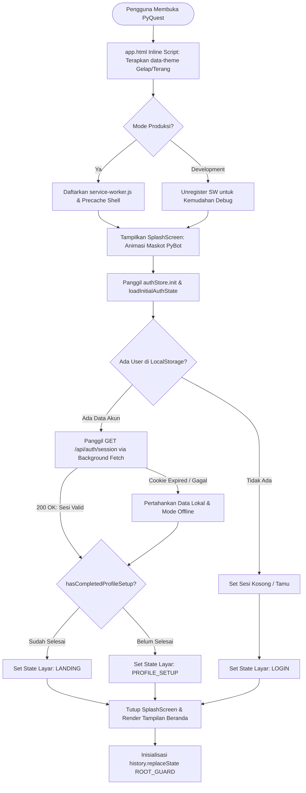
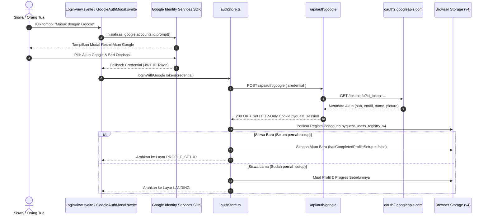
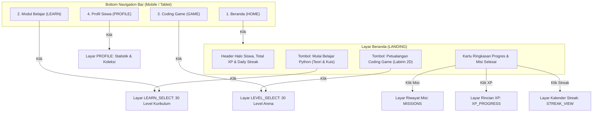
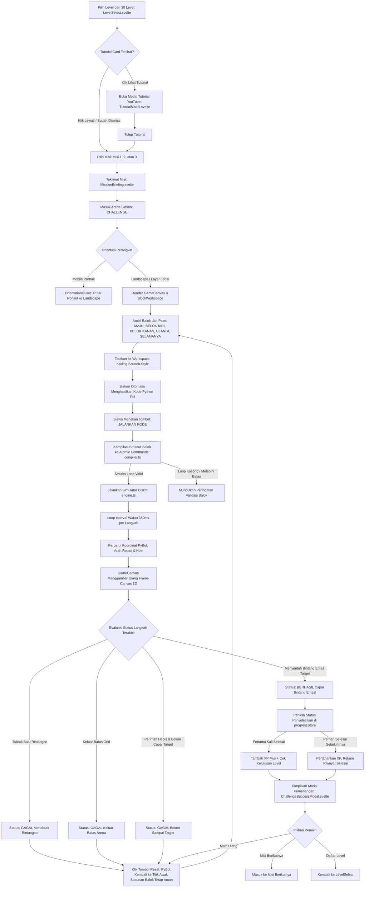
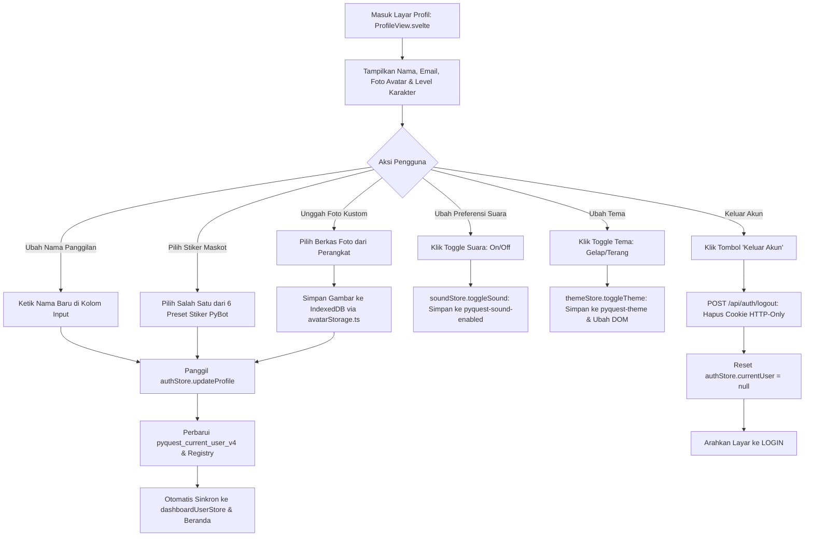
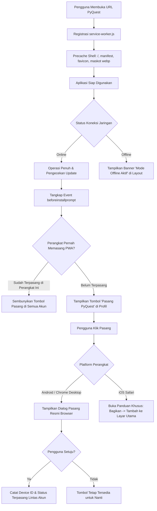
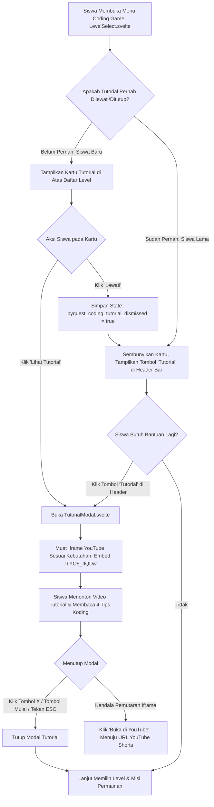

# PyQuest — Detailed Application Flows & User Journeys

> **Pemetaan Lengkap Perjalanan Pengguna, Transisi Antarmuka, dan Status Verifikasi Implementasi Riil**  
> Repositori: `pyquest` | Seluruh alur diverifikasi langsung terhadap kode sumber aktual.

---

## Daftar Isi
1. [Alur Startup Aplikasi & Inisialisasi Sesi](#1-alur-startup-aplikasi--inisialisasi-sesi)
2. [Alur Autentikasi Google & Pendaftaran Akun Pertama Kali](#2-alur-autentikasi-google--pendaftaran-akun-pertama-kali)
3. [Alur Beranda & Navigasi Utama](#3-alur-beranda--navigasi-utama)
4. [Alur Modul Belajar Python & Kuis Interaktif (150 Soal)](#4-alur-modul-belajar-python--kuis-interaktif-150-soal)
5. [Alur Coding Game — Siklus Eksekusi Penuh (90 Misi Labirin)](#5-alur-coding-game--siklus-eksekusi-penuh-90-misi-labirin)
6. [Alur Pengaturan Profil Siswa & Akun](#6-alur-pengaturan-profil-siswa--akun)
7. [Alur Pengaturan Efek Suara Web Audio API](#7-alur-pengaturan-efek-suara-web-audio-api)
8. [Alur Pengaturan Tema Gelap & Terang](#8-alur-pengaturan-tema-gelap--terang)
9. [Alur Navigasi Tombol Back Mobile & Riwayat Browser](#9-alur-navigasi-tombol-back-mobile--riwayat-browser)
10. [Alur Progressive Web App (PWA) & Operasi Offline](#10-alur-progressive-web-app-pwa--operasi-offline)
11. [Alur Onboarding Siswa Baru & Tutorial Coding Game](#11-alur-onboarding-siswa-baru--tutorial-coding-game)

---

## 1. Alur Startup Aplikasi & Inisialisasi Sesi

### 1.1 Diagram Alur (Mermaid)


### 1.2 Rincian Alur
- **Titik Masuk (*Entry Point*)**: `src/app.html`, `src/routes/+layout.svelte`, dan `src/routes/+page.svelte`.
- **Langkah & Transisi**:
  1. Skrip sinkron di `<head>` `src/app.html` langsung mengekstrak nilai tema dari `localStorage.getItem('pyquest-theme')` dan menyetel atribut `data-theme` pada elemen `<html>`. Hal ini mencegah terjadinya *flash of unstyled content* (FOUC) atau kedipan layar putih sebelum styling Svelte termuat.
  2. Komponen `SplashScreen.svelte` dimunculkan seketika dengan gambar maskot resmi PyBot (`/mascot/pybot-waving.webp`) dan indikator pemuatan beranimasi halus.
  3. `authStore.ts` menjalankan `loadInitialAuthState()` secara sinkron untuk memulihkan objek `currentUser` dari kunci `pyquest_current_user_v4`.
  4. Bila data lokal ditemukan, fungsi latar belakang mengecek keabsahan cookie HTTP-Only via `GET /api/auth/session`.
  5. Bila cookie valid atau dalam keadaan offline mandiri, sistem memeriksa flag `hasCompletedProfileSetup`:
     - Jika `true`: Navigasi langsung menuju Beranda (`LANDING`).
     - Jika `false`: Pengguna diarahkan menyelesaikan penyiapan nama/avatar di `PROFILE_SETUP`.
  6. Bila tidak ada sesi pengguna sama sekali, layar diarahkan ke `LOGIN`.
  7. Setelah status ditentukan, layar pembuka (*splash screen*) ditutup secara mulus (`isSplashVisible = false`) dan tumpukan riwayat browser diinisialisasi dengan state sentinel `ROOT_GUARD`.
- **Berkas Terkait**:
  - `src/app.html`
  - `src/routes/+layout.svelte`
  - `src/routes/+page.svelte`
  - `src/lib/components/SplashScreen.svelte`
  - `src/lib/stores/authStore.ts`
  - `src/routes/api/auth/session/+server.ts`
- **Data yang Dibaca / Ditulis**:
  - Dibaca: `pyquest-theme`, `pyquest_current_user_v4`, cookie `pyquest_session`.
  - Ditulis: Status reaktif `authStore`, `themeStore`, flag status splash screen.
- **Status Implementasi**: **TERVERIFIKASI & PASS** (Teruji di environment browser dan unit tests).

---

## 2. Alur Autentikasi Google & Pendaftaran Akun Pertama Kali

### 2.1 Diagram Alur (Mermaid)


### 2.2 Rincian Alur
- **Titik Masuk (*Entry Point*)**: `src/lib/components/LoginView.svelte` atau modal `src/lib/components/GoogleAuthModal.svelte`.
- **Langkah & Transisi**:
  1. Pengguna memicu login Google resmi melalui SDK Google Identity Services (`https://accounts.google.com/gsi/client`).
  2. Token kredensial JWT dikirimkan ke endpoint SvelteKit backend `POST /api/auth/google`.
  3. Server memverifikasi integritas tanda tangan kriptografis token secara langsung ke server resmi Google (`oauth2.googleapis.com/tokeninfo`).
  4. Server menyetel cookie sesi `pyquest_session` dengan keamanan tingkat tinggi: `httpOnly: true`, `sameSite: 'lax'`, `secure: true` (saat production), durasi aktif 30 hari.
  5. `authStore.ts` mengecek `USERS_REGISTRY_KEY` lokal (`pyquest_users_registry_v4`):
     - Jika ID Google belum ada dalam registri, profil ditandai sebagai pengguna baru (`hasCompletedProfileSetup: false`) dan layar beralih ke `PROFILE_SETUP`.
     - Jika ID Google sudah terdaftar, profil dimuat lengkap dengan avatar kustomnya, lalu diarahkan ke Beranda (`LANDING`).
  6. Bila pengguna membatalkan pop-up Google atau koneksi terputus, pesan galat ramah ditampilkan tanpa merusak antarmuka.
- **Berkas Terkait**:
  - `src/lib/components/LoginView.svelte`
  - `src/lib/components/GoogleAuthModal.svelte`
  - `src/lib/stores/authStore.ts`
  - `src/lib/utils/googleAuth.ts`
  - `src/routes/api/auth/google/+server.ts`
- **Status Implementasi**: **TERVERIFIKASI & PASS** (Teruji dengan 6 unit tests auth pada `src/engine.test.ts`).

---

## 3. Alur Beranda & Navigasi Utama

### 3.1 Diagram Alur (Mermaid)


### 3.2 Rincian Alur
- **Titik Masuk (*Entry Point*)**: Layar `LANDING` (`src/lib/components/LandingHero.svelte`).
- **Langkah & Transisi**:
  1. Komponen `LandingHero.svelte` menampilkan sapaan personal ramah anak menggunakan nama panggilan (`Halo, {firstName}!`), ringkasan status *Daily Streak*, dan total XP saat ini.
  2. Dua kartu panggilan aksi (CTA) berukuran besar dan mudah ditekan:
     - *"Mulai Belajar Python"* $\to$ membuka modul teori dan kuis (`LEARN_SELECT`).
     - *"Petualangan Coding Game"* $\to$ membuka arena labirin koding visual (`LEVEL_SELECT`).
  3. Pada tampilan mobile (<768px), `BottomNav.svelte` menyediakan tepat 4 destinasi tetap: Beranda, Modul, Game, dan Profil.
  4. Bilah bawah `BottomNav.svelte` dilengkapi fitur *smart auto-hide*: otomatis menyusut saat pengguna menggulir ke bawah (*scroll down*) dan muncul kembali saat menggulir ke atas (*scroll up*) guna memperluas bidang sentuh anak.
  5. Pada tampilan desktop, navigasi samping `Sidebar.svelte` dan bilah atas `Navbar.svelte` memudahkan transisi layar.
- **Berkas Terkait**:
  - `src/lib/components/LandingHero.svelte`
  - `src/lib/components/BottomNav.svelte`
  - `src/lib/components/Navbar.svelte`
  - `src/lib/components/Sidebar.svelte`
  - `src/routes/+page.svelte`
- **Status Implementasi**: **TERVERIFIKASI & PASS**.

---

## 4. Alur Modul Belajar Python & Kuis Interaktif (150 Soal)

### 4.1 Diagram Alur (Mermaid)
```mermaid
flowchart TD
    EnterLearn[Pilih Level dari 30 Level: LearningLevelSelect.svelte] --> CheckLvlLock{Level Terbuka?}
    CheckLvlLock -->|Terkunci| ShowToast[Munculkan Toast: Selesaikan level sebelumnya]
    CheckLvlLock -->|Terbuka| OpenLesson[Buka Modul Belajar & Soal Pertama: QuestionCard.svelte]

    OpenLesson --> ReadMaterial[Anak Membaca Materi, Contoh Kode Python & Petunjuk]
    ReadMaterial --> HelpNeeded{Perlu Bantuan?}
    HelpNeeded -->|Ya| ClickHint[Klik Petunjuk: Tampilkan Hint Bertingkat yang Mendidik]
    HelpNeeded -->|Tidak| ChooseAnswer[Pilih Opsi Jawaban: A, B, C, atau D]
    ClickHint --> ChooseAnswer

    ChooseAnswer --> EvalEngine[Evaluasi Jawaban Deterministik: quizEvaluator.ts]
    EvalEngine --> PlaySfx[Web Audio API: playCorrect / playIncorrect]
    PlaySfx --> ShowFeedbackModal[Tampilkan Modal Feedback: FeedbackModal.svelte]

    ShowFeedbackModal --> NextBtnClick[Klik 'Lanjut ke Soal Berikutnya']
    NextBtnClick --> MoreQuestions{Masih Ada Soal di Level Ini? (Total 5 Soal)}
    MoreQuestions -->|Ya| LoadNextQ[Muat Soal Berikutnya di Level yang Sama]
    MoreQuestions -->|Tidak| CalculateScore[Kalkulasi Ringkasan Skor & Persentase Kelulusan]

    CalculateScore --> CheckFirstPass{Pertama Kali Lulus Level Ini?}
    CheckFirstPass -->|Ya| AddRewardXP[progressStore.completeLearningLevel: Tambah XP + Buka Level Berikutnya]
    CheckFirstPass -->|Replay / Sudah Pernah| KeepHighestScore[Perbarui Rekor Skor Terbaik, 0 Tambahan XP]

    AddRewardXP --> ShowSuccessModal[Tampilkan Modal Kelulusan: LearningSuccessModal.svelte]
    KeepHighestScore --> ShowSuccessModal

    ShowSuccessModal --> ActionChoice{Pilihan Siswa}
    ActionChoice -->|Lanjut Level Berikutnya| OpenNextLevel[Buka Level Belajar Berikutnya]
    ActionChoice -->|Ulangi Level Ini| ReplayCurrent[Ulangi Kuis untuk Nilai Sempurna 100%]
    ActionChoice -->|Kembali ke Menu| ReturnToSelection[Kembali ke Daftar Level: LEARN_SELECT]
```

### 4.2 Rincian Alur
- **Titik Masuk (*Entry Point*)**: Layar `LEARN_SELECT` (`src/lib/components/LearningLevelSelect.svelte`).
- **Langkah & Transisi**:
  1. Kurikulum terdiri dari 30 level bergradasi (Level 1: Konsep Variabel hingga Level 30: Proyek Terpadu).
  2. Masing-masing level memuat tepat 5 soal kurasi bermutu (total 150 bank soal pada `questionsData.ts`).
  3. Soal disajikan melalui `QuestionCard.svelte` yang menampilkan sintaks kode Python terformat rapi dan opsi jawaban yang diacak urutan tampilannya.
  4. Tersedia tombol petunjuk (*hint*) pedagogis yang membimbing logika siswa tanpa membocorkan kunci jawaban langsung.
  5. Evaluasi jawaban ditangani oleh `quizEvaluator.ts`:
     - Jawaban benar memutar efek suara nada manis (*sweet chime*).
     - Jawaban salah memutar nada lembut (*soft boop*) disertai penjelasan konsep yang ramah.
     - Dilengkapi mekanisme anti-klik ganda (*double-submit protection*).
  6. Pada akhir kuis, jika siswa pertama kali menyelesaikan level, fungsi `completeLearningLevel()` di `progressStore.ts` menambahkan reward XP dan otomatis membuka (*unlock*) level berikutnya.
  7. Pada saat pengerjaan ulang (*replay*), skor tertinggi diperbarui namun penambahan reward XP dicegah (*anti-duplicate XP guard*).
- **Berkas Terkait**:
  - `src/lib/components/LearningLevelSelect.svelte`
  - `src/lib/components/QuestionCard.svelte`
  - `src/lib/components/FeedbackModal.svelte`
  - `src/lib/components/LearningSuccessModal.svelte`
  - `src/lib/questions/learningLevelsData.ts`
  - `src/lib/questions/questionsData.ts`
  - `src/lib/questions/quizEvaluator.ts`
- **Status Implementasi**: **TERVERIFIKASI & PASS** (Teruji dengan 19 unit tests soal dan kuis pada `src/engine.test.ts`).

---

## 5. Alur Coding Game — Siklus Eksekusi Penuh (90 Misi Labirin)

### 5.1 Diagram Alur (Mermaid)


### 5.2 Rincian Alur
- **Titik Masuk (*Entry Point*)**: Layar `LEVEL_SELECT` (`src/lib/components/LevelSelect.svelte`).
- **Langkah & Transisi**:
  1. Katalog terdiri dari 30 level yang dikelompokkan ke dalam 8 Unit Pembelajaran tematik (Gerakan Dasar, Belokan & Rotasi, Loop `for`, Pola Tangga, Labirin Berkelok, dll.).
  2. Masing-masing level memiliki 3 variasi misi (total 90 konfigurasi labirin pada `challengesData.ts`).
  3. Di dalam arena `CHALLENGE`:
     - Sisi kiri: `GameCanvas.svelte` merender grid 2D dengan koordinat diskrit, sprite PyBot, koin berkilau, rintangan batu, dan bintang target emas.
     - Sisi kanan: `BlockWorkspace.svelte` menyediakan balok perintah berujung membulat halus khas Scratch 3 (`MAJU`, `BELOK KIRI`, `BELOK KANAN`, `ULANGI N KALI`, `SELAMANYA`).
  4. Penyusunan balok secara *real-time* merefleksikan kode Python murni (`pybot.move()`, `pybot.turn_left()`, `for _ in range(3):`).
  5. Saat tombol *"JALANKAN KODE"* ditekan:
     - `compiler.ts` mengonversi balok visual menjadi instruksi atomik diskrit.
     - `engine.ts` mengeksekusi langkah demi langkah pada interval 380ms per *tick*.
     - Tabrakan rintangan (`COLLISION`) atau keluar batas arena (`OUT_OF_BOUNDS`) menghentikan simulasi seketika dengan pesan edukatif.
     - Tombol reset mengembalikan robot ke posisi awal tanpa menghapus balok yang telah disusun, sehingga anak dapat langsung memperbaiki logika kodingnya.
  6. Kemenangan dicapai saat PyBot menyentuh bintang emas:
     - Misi pertama kali diselesaikan $\to$ penambahan XP misi dicatat permanen ke `progressStore`.
     - Bila seluruh 3 misi dalam satu level rampung, bonus pencapaian level (*level achievement*) turut diberikan.
     - Modal kemenangan `ChallengeSuccessModal.svelte` menampilkan selebrasi bintang dan skor perolehan.
- **Berkas Terkait**:
  - `src/lib/components/LevelSelect.svelte`
  - `src/lib/components/MissionBriefing.svelte`
  - `src/lib/components/GameCanvas.svelte`
  - `src/lib/components/BlockWorkspace.svelte`
  - `src/lib/components/ChallengeSuccessModal.svelte`
  - `src/lib/components/TutorialModal.svelte`
  - `src/lib/challenges/challengesData.ts`
  - `src/lib/challenges/levelsData.ts`
  - `src/lib/game/compiler.ts`
  - `src/lib/game/engine.ts`
  - `src/lib/game/validator.ts`
- **Status Implementasi**: **TERVERIFIKASI & PASS** (Teruji dengan 20 unit tests game engine dan solver BFS pada `src/engine.test.ts`).

---

## 6. Alur Pengaturan Profil Siswa & Akun

### 6.1 Diagram Alur (Mermaid)


### 6.2 Rincian Alur
- **Titik Masuk (*Entry Point*)**: Layar `PROFILE` (`src/lib/components/ProfileView.svelte`) atau `PROFILE_SETUP` (`src/lib/components/ProfileSetup.svelte`).
- **Langkah & Transisi**:
  1. Siswa dapat menyunting nama panggilan dan memilih representasi visual avatar.
  2. Tersedia preset stiker karakter resmi PyBot serta dukungan unggah foto kustom.
  3. Foto kustom disimpan ke IndexedDB melalui `avatarStorage.ts` guna mencegah meluapnya kuota `localStorage` browser yang terbatas (maksimal 5MB).
  4. Perubahan profil secara instan memicu pemutakhiran store reaktif `$dashboardUserStore` dan registri pengguna `USERS_REGISTRY_KEY`.
  5. Pengaturan audio dan tema dapat diubah langsung melalui toggle switch di kartu pengaturan.
  6. Tombol keluar (*Log Out*) memanggil endpoint `POST /api/auth/logout` untuk menghapus cookie sesi server dan membersihkan state aktif di peramban.
- **Berkas Terkait**:
  - `src/lib/components/ProfileView.svelte`
  - `src/lib/components/ProfileSetup.svelte`
  - `src/lib/utils/avatarStorage.ts`
  - `src/lib/stores/authStore.ts`
  - `src/routes/api/auth/logout/+server.ts`
- **Status Implementasi**: **TERVERIFIKASI & PASS**.

---

## 7. Alur Pengaturan Efek Suara Web Audio API

### 7.1 Rincian Alur
- **Prinsip Tanpa Aset Eksternal (*Zero-Asset Synthesizer*)**:
  - `soundStore.ts` menggunakan Web Audio API murni (`AudioContext`, `OscillatorNode`, `GainNode`).
  - Aplikasi tidak memuat berkas MP3/WAV eksternal sehingga tidak memakan bandwidth data dan bekerja 100% instan di perangkat tanpa jeda jaringan.
- **Daftar Suara yang Diimplementasikan & Terverifikasi**:
  1. `playClick()`: Nada klik antarmuka lembut frekuensi 600Hz durasi 40ms.
  2. `playCorrect()`: Akor harmonis dua nada (C5 & E5) untuk apresiasi jawaban kuis yang benar.
  3. `playIncorrect()`: Nada rendah (180Hz ke 140Hz) bergelombang halus untuk evaluasi salah.
  4. `playRobotMove()`: Frekuensi sapuan (*sweep tone*) 320Hz ke 480Hz yang menyertai setiap langkah PyBot di arena labirin.
  5. `playCoinCollect()`: Arpeggio nada tinggi ceria (988Hz ke 1318Hz) saat PyBot memungut koin.
  6. `playMissionComplete()`: Melodi selebrasi kemenangan akor mayor (C-E-G-C) saat menyentuh bintang emas.
- **Penyimpanan Preferensi**:
  - Disimpan pada `localStorage` dengan kunci `pyquest-sound-enabled` (`"true"` atau `"false"`).
  - Dilengkapi mekanisme *throttling* waktu untuk mencegah kejenuhan pendengaran anak akibat penekanan tombol cepat berulang.
- **Berkas Terkait**:
  - `src/lib/stores/soundStore.ts`
- **Status Implementasi**: **TERVERIFIKASI & PASS**.

---

## 8. Alur Pengaturan Tema Gelap & Terang

### 8.1 Rincian Alur
- **Penetapan Tema Awal (*Initial Resolution*)**:
  1. Skrip sinkron inline pada `src/app.html` langsung memeriksa `localStorage.getItem('pyquest-theme')`.
  2. Jika belum tersimpan, default aplikasi adalah tema gelap (*dark theme*) bernuansa luar angkasa dengan latar biru dongker sci-fi (`#020617`).
  3. Mengatur atribut `<html data-theme="dark" class="dark">` sebelum rendering DOM dimulai.
- **Sinkronisasi Dinamis**:
  - Perpindahan tema memutakhirkan token CSS Tailwind v4.
  - Memutakhirkan elemen `<meta name="theme-color">` pada status bar browser mobile (Gelap: `#020617`, Terang: `#f8fafc`).
- **Berkas Terkait**:
  - `src/app.html`
  - `src/app.css`
  - `src/lib/stores/themeStore.ts`
- **Status Implementasi**: **TERVERIFIKASI & PASS**.

---

## 9. Alur Navigasi Tombol Back Mobile & Riwayat Browser

### 9.1 Diagram Alur (Mermaid)
```mermaid
flowchart TD
    DeviceBack[Pengguna Menekan Tombol Back Android / Browser] --> CatchPopstate[Ditangkap oleh Event Listener popstate pada +page.svelte]
    CatchPopstate --> CheckAuthModal{Apakah Modal Login Google Terbuka?}
    
    CheckAuthModal -->|Ya| CloseModalOnly[Tutup Modal Saja, Pertahankan Posisi Layar Aktif]
    CheckAuthModal -->|Tidak| CheckDetailModal{Apakah Modal Detail Misi Terbuka?}

    CheckDetailModal -->|Ya| CloseDetailOnly[Tutup Modal Detail Misi]
    CheckDetailModal -->|Tidak| CheckTutorialModal{Apakah Modal Tutorial Koding Terbuka?}

    CheckTutorialModal -->|Ya| CloseTutorialOnly[Tutup Modal Tutorial]
    CheckTutorialModal -->|Tidak| CheckCurrentScreen{Periksa Layar Aktif Saat Ini}

    CheckCurrentScreen -->|CHALLENGE / MISSION_BRIEFING| NavToLevelList[Mundur ke Daftar Level: LEVEL_SELECT]
    CheckCurrentScreen -->|QUESTION / FEEDBACK / SUCCESS| NavToLearnList[Mundur ke Daftar Modul: LEARN_SELECT]
    CheckCurrentScreen -->|LEVEL_SELECT / LEARN_SELECT / PROFILE| NavToLanding[Mundur ke Beranda: LANDING]
    CheckCurrentScreen -->|MISSIONS / XP_PROGRESS / STREAK_VIEW| NavToLanding
    CheckCurrentScreen -->|LANDING (State: ROOT_GUARD)| HandleExit[Panggil handlePlatformExit: Keluar Aplikasi / Tab Terakhir]
```

### 9.2 Rincian Alur
- **Pencegahan Keluar Tidak Sengaja**:
  - Pada aplikasi web biasa, tombol Back fisik di Android sering menutup jendela peramban seketika.
  - PyQuest mengelola tumpukan riwayat buatan (*synthetic history stack*) via `history.pushState` dan `history.replaceState`.
  - Beranda diproteksi dengan sentinel `ROOT_GUARD`.
  - Tombol Back memprioritaskan penutupan modal aktif (modal auth, modal detail misi, atau modal tutorial YouTube) sebelum memindahkan navigasi layar.
  - Berpindah mundur secara hierarkis: dari arena permainan $\to$ daftar level $\to$ beranda $\to$ konfirmasi keluar peramban.
- **Berkas Terkait**:
  - `src/routes/+page.svelte` (penanganan `handlePopState`, `navigateTo`, dan `handlePlatformExit`).
- **Status Implementasi**: **TERVERIFIKASI & PASS**.

---

## 10. Alur Progressive Web App (PWA) & Operasi Offline

### 10.1 Diagram Alur (Mermaid)


### 10.2 Rincian Alur
- **Deteksi Perangkat Lintas Akun (*Multi-Account Device Detection*)**:
  - Mengatasi masalah umum pada perangkat keluarga atau sekolah di mana satu tablet digunakan oleh beberapa anak.
  - Menggunakan kombinasi penanda persisten (`pyquest_device_id_v1` dan `pyquest_device_pwa_installed_v1`) yang tersimpan di tingkat peramban lokal perangkat.
  - Sekali aplikasi dipasang sebagai PWA di perangkat tersebut, tombol pasang aplikasi disembunyikan untuk seluruh akun yang login di perangkat yang sama.
- **Strategi Caching Service Worker**:
  - Shell aplikasi (`/`, berkas CSS, skrip JS yang di-*hash*, gambar WebP maskot) di-cache secara *cache-first*.
  - Skenario tanpa internet (*offline*) didukung penuh untuk Modul Belajar, Kuis 150 Soal, dan Coding Game 90 Misi.
- **Berkas Terkait**:
  - `src/service-worker.js`
  - `src/lib/stores/pwaStore.ts`
  - `src/lib/components/ProfileView.svelte`
  - `src/lib/components/InstallGuideModal.svelte`
  - `static/manifest.json`
- **Status Implementasi**: **TERVERIFIKASI & PASS**.

---

## 11. Alur Onboarding Siswa Baru & Tutorial Coding Game

### 11.1 Diagram Alur (Mermaid)


### 11.2 Rincian Alur
- **Titik Masuk (*Entry Point*)**: Layar `LEVEL_SELECT` (`src/lib/components/LevelSelect.svelte`).
- **Kartu Onboarding (*Tutorial Card*)**:
  - Ditempatkan tepat di bagian atas menu Coding Game sebelum daftar level.
  - Teks terstandarisasi:
    - Judul: *"Baru pertama bermain?"*
    - Deskripsi: *"Pelajari cara menyusun blok dan menggerakkan PyBot."*
    - Tombol Aksi Utama: *"Lihat Tutorial"*
    - Tombol Sekunder: *"Lewati"*
- **Penyimpanan State Penolakan (*Dismissal Persistence*)**:
  - Status tersimpan pada `localStorage` dengan kunci `pyquest_coding_tutorial_dismissed`.
  - Jika pengguna memilih *"Lewati"*, kartu disembunyikan agar tidak memakan ruang pandang, namun tombol *"Tutorial"* berukuran ringkas tetap tersedia pada *top bar* kapan pun siswa ingin menonton ulang.
- **Pemuatan Pemutar Video Sesuai Kebutuhan (*Lazy Loaded YouTube Embed*)**:
  - Tag `<iframe>` pemutar YouTube **tidak pernah dimuat** pada saat startup aplikasi atau di halaman beranda guna menghemat kuota internet dan menjaga performa rendering tetap instan.
  - Iframe hanya dibuat dan dihubungkan ke `https://www.youtube.com/embed/rTYO5_IfQDw` saat pengguna secara eksplisit menekan tombol *"Lihat Tutorial"*.
  - Pemutaran otomatis (*autoplay*) dinonaktifkan demi kenyamanan anak.
  - Tersedia tombol tautan cadangan *"Buka di YouTube"* (`https://www.youtube.com/shorts/rTYO5_IfQDw`) apabila peramban memblokir frame pihak ketiga.
  - Dilengkapi ringkasan 4 langkah koding cepat mencakup: pemilihan misi, penyusunan balok, pemanfaatan loop, dan eksekusi koding berhadiah XP.
- **Berkas Terkait**:
  - `src/lib/components/LevelSelect.svelte`
  - `src/lib/components/TutorialModal.svelte`
- **Status Implementasi**: **TERVERIFIKASI & PASS**.
