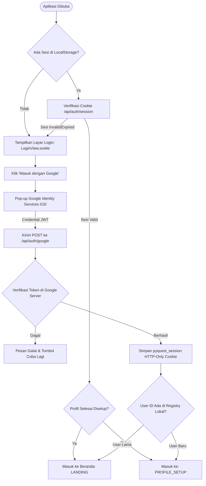
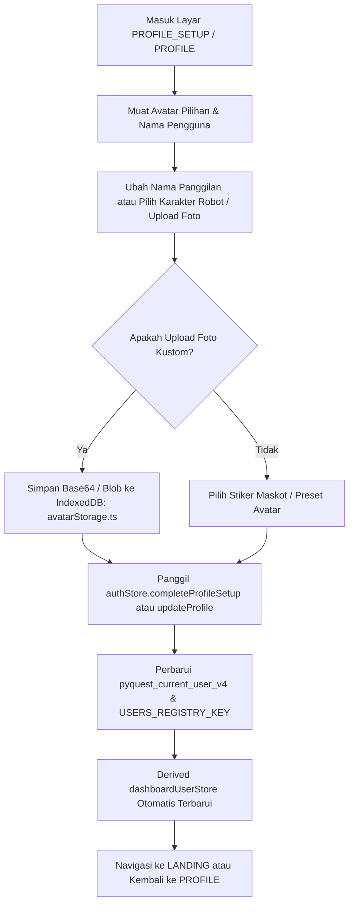
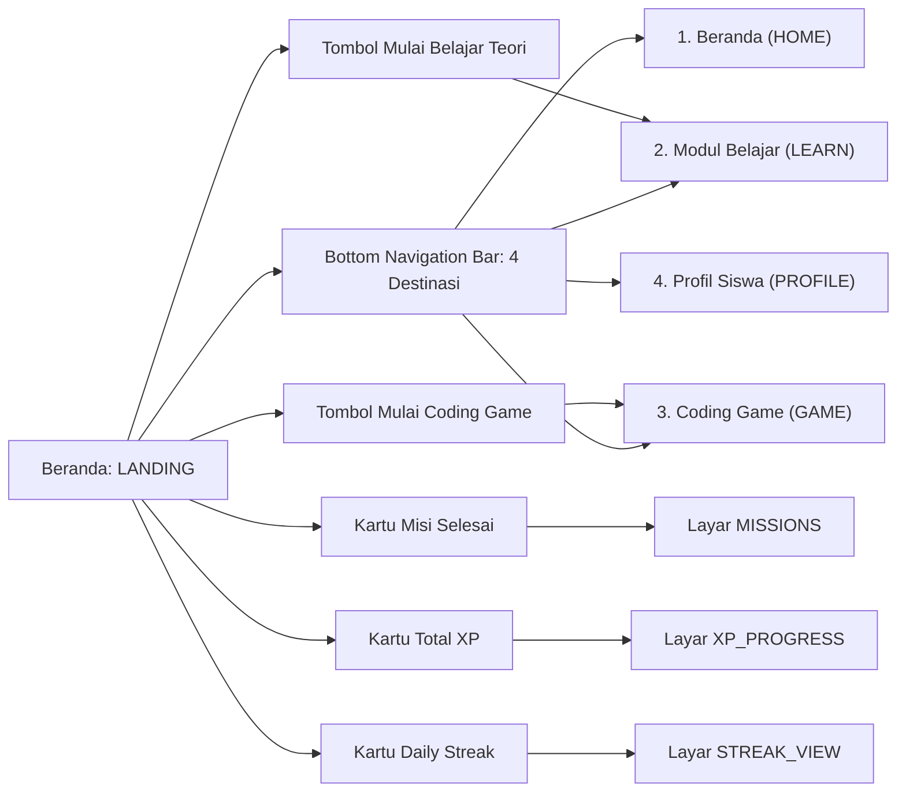
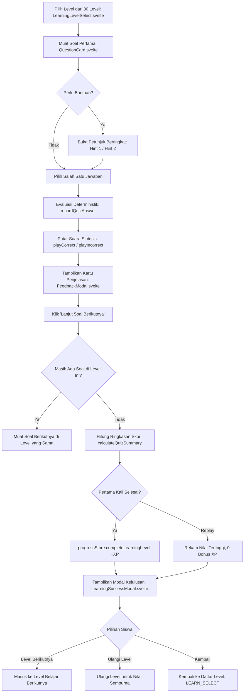
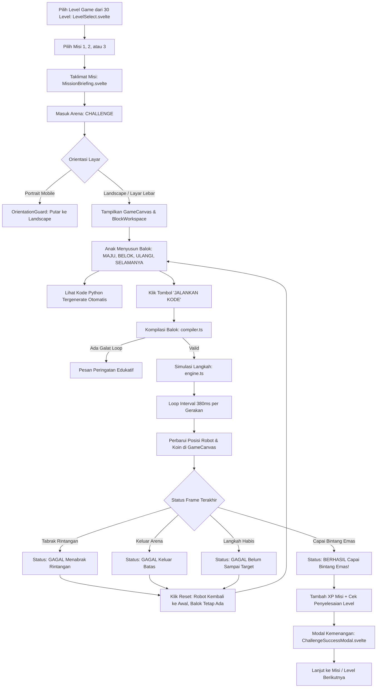
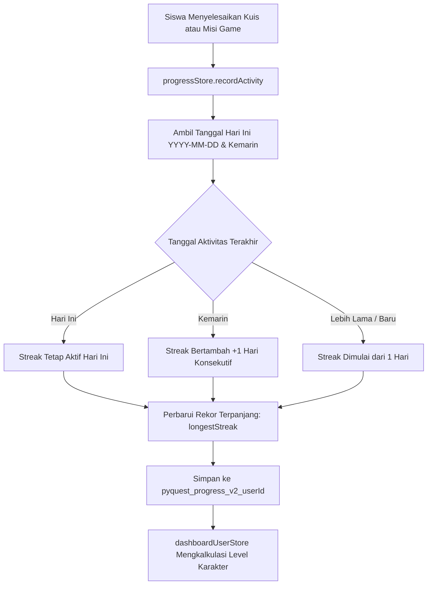
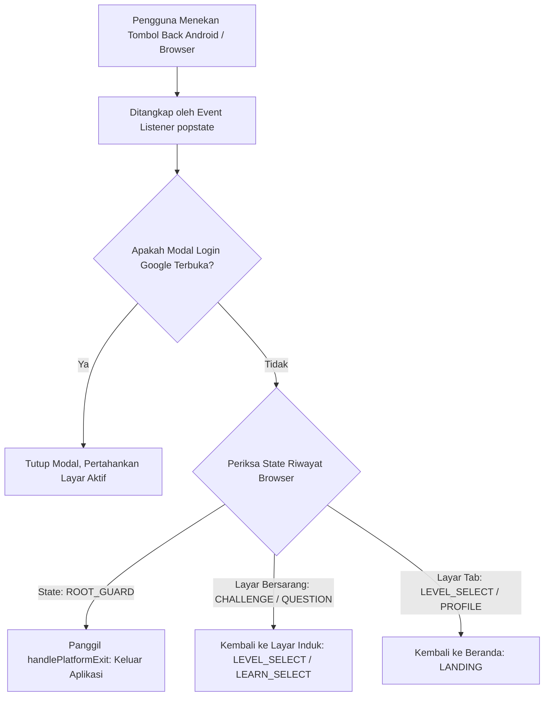
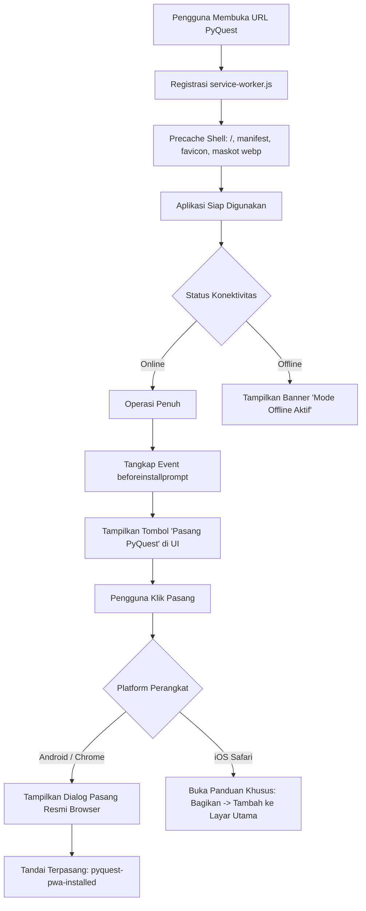

# PyQuest — Detailed Application Flows & User Journeys

> **Pemetaan Lengkap Perjalanan Pengguna, Transisi Layar, dan Status Implementasi Riil**  
> Repositori: `pyquest` | Seluruh alur diverifikasi langsung terhadap kode sumber aktual.

---

## 1. Alur Autentikasi Pengguna (Google Login & Returning User)

### 1.1 Diagram Alur (Mermaid)

### 1.2 Rincian Alur
- **Titik Masuk (*Entry Point*)**: Layar `LOGIN` (`src/lib/components/LoginView.svelte`) atau modal `GoogleAuthModal.svelte`.
- **Langkah & Transisi**:
  1. `loadInitialAuthState()` memeriksa `localStorage` (`pyquest_current_user_v4`). Jika ada, sesi dimuat seketika tanpa flash screen login.
  2. Inisialisasi latar belakang memanggil `GET /api/auth/session` untuk memastikan cookie sesi server tetap valid.
  3. Saat pengguna baru mengklik login Google, Google Identity Services merender tombol One Tap / modal Google Sign-In resmi.
  4. Credential JWT dikirim ke `POST /api/auth/google`. Server memverifikasi token ke `oauth2.googleapis.com/tokeninfo`, memeriksa masa berlaku dan Audience ID.
  5. Jika lolos verifikasi, cookie `pyquest_session` disetel dengan atribut `httpOnly`, `sameSite=lax`, `secure` (production), durasi 30 hari.
  6. Bila akun belum pernah menyelesaikan setup nama/avatar (`hasCompletedProfileSetup: false`), layar berpindah ke `PROFILE_SETUP`. Jika sudah pernah, langsung diarahkan ke `LANDING`.
- **Berkas Terkait**:
  - `src/lib/components/LoginView.svelte`
  - `src/lib/components/GoogleAuthModal.svelte`
  - `src/lib/stores/authStore.ts`
  - `src/routes/api/auth/google/+server.ts`
  - `src/routes/api/auth/session/+server.ts`
- **Data yang Dibaca / Ditulis**:
  - Dibaca: Token Google JWT, cookie `pyquest_session`, `pyquest_current_user_v4`, `pyquest_users_registry_v4`.
  - Ditulis: Cookie sesi HTTP-Only, profil akun di localStorage, state reaktif `authStore`.
- **Status Implementasi**: **TERVERIFIKASI & PASS** (Didukung oleh 6 unit tests auth di `src/engine.test.ts`).
- **Catatan & Keterbatasan**: Memerlukan koneksi internet saat login pertama untuk verifikasi token Google. Setelah login berhasil, seluruh sesi dan progres tersimpan lokal di perangkat dan dapat berjalan offline.

---

## 2. Alur Pengaturan & Penyuntingan Profil

### 2.1 Diagram Alur (Mermaid)

### 2.2 Rincian Alur
- **Titik Masuk (*Entry Point*)**: Layar `PROFILE_SETUP` (`ProfileSetup.svelte`) untuk pengguna baru, atau layar `PROFILE` (`ProfileView.svelte`) via navigasi bawah / samping.
- **Langkah & Transisi**:
  1. Pengguna dapat memilih preset stiker PyBot resmi (berbagai ekspresi) atau mengunggah gambar kustom.
  2. Gambar kustom disimpan ke IndexedDB lokal melalui `avatarStorage.ts` untuk menghindari kuota penyimpanan localStorage yang sempit (5MB).
  3. Nama anak divalidasi dan dipotong nama panggilan pertamanya (`firstName`) untuk sapaan ramah di Beranda.
  4. Penyimpanan persisten memutakhirkan `USERS_REGISTRY_KEY` sehingga saat berganti akun Google di perangkat yang sama, data profil tetap terpisah rapi.
- **Berkas Terkait**:
  - `src/lib/components/ProfileSetup.svelte`
  - `src/lib/components/ProfileView.svelte`
  - `src/lib/utils/avatarStorage.ts`
  - `src/lib/stores/authStore.ts`
- **Data yang Dibaca / Ditulis**:
  - Dibaca: Data akun Google, IndexedDB `pyquest_db/avatars`.
  - Ditulis: Profil `UserProfile` di localStorage dan IndexedDB.
- **Status Implementasi**: **TERVERIFIKASI & PASS** (Teruji di `src/engine.test.ts`).

---

## 3. Alur Beranda & Navigasi Utama

### 3.1 Diagram Alur (Mermaid)

### 3.2 Rincian Alur
- **Titik Masuk (*Entry Point*)**: Layar `LANDING` (`LandingHero.svelte`).
- **Langkah & Transisi**:
  1. Header menyapa nama pengguna (`Halo, {firstName}!`), menampilkan status streak harian dan total XP.
  2. Menyediakan 2 tombol aksi utama: *"Mulai Belajar Python"* dan *"Petualangan Coding Game"*.
  3. Menampilkan kartu progres cepat: misi selesai, level belajar aktif, rekor streak aktif.
  4. Pada layar mobile, bilah bawah `BottomNav.svelte` otomatis menyembunyikan diri saat pengguna menggulir ke bawah (*scroll down*) dan muncul kembali saat menggulir ke atas (*scroll up*) untuk memaksimalkan area pandang anak.
- **Berkas Terkait**:
  - `src/lib/components/LandingHero.svelte`
  - `src/lib/components/BottomNav.svelte`
  - `src/lib/components/Sidebar.svelte`
- **Status Implementasi**: **TERVERIFIKASI & PASS**.

---

## 4. Alur Modul Belajar Python & Kuis Interaktif (150 Soal)

### 4.1 Diagram Alur (Mermaid)

### 4.2 Rincian Alur
- **Titik Masuk (*Entry Point*)**: Layar `LEARN_SELECT` (`LearningLevelSelect.svelte`).
- **Langkah & Transisi**:
  1. Menampilkan 30 level kurikulum Python terstruktur (Variabel, Tipe Data, Operator, Kondisi `if/else`, Perulangan `for/while`, Logika Dasar).
  2. Setiap level terdiri dari tepat 5 pertanyaan (total 150 bank soal pada `questionsData.ts`).
  3. `QuestionCard.svelte` menampilkan teks soal, blok kode sintaks Python, opsi pilihan acak, dan tombol petunjuk bertingkat yang tidak membocorkan kunci jawaban langsung.
  4. Siswa memilih jawaban $\to$ dievaluasi seketika oleh `quizEvaluator.ts` dengan perlindungan anti-klik ganda.
  5. Penjelasan edukatif ramah anak ditampilkan di `FeedbackModal.svelte`.
  6. Setelah soal ke-5 selesai, `calculateQuizSummary()` menghitung persentase kebenaran, status kesempurnaan (*perfect score* 5/5), dan memicu selebrasi kelulusan di `LearningSuccessModal.svelte`.
- **Berkas Terkait**:
  - `src/lib/components/LearningLevelSelect.svelte`
  - `src/lib/components/QuestionCard.svelte`
  - `src/lib/components/FeedbackModal.svelte`
  - `src/lib/components/LearningSuccessModal.svelte`
  - `src/lib/questions/questionsData.ts`
  - `src/lib/questions/learningLevelsData.ts`
  - `src/lib/questions/quizEvaluator.ts`
- **Data yang Dibaca / Ditulis**:
  - Dibaca: Bank soal `questionsData`, level belajar `learningLevelsData`.
  - Ditulis: `completedLearningLevels`, `learningLevelScores`, `completedQuestions`, dan akumulasi XP di `progressStore`.
- **Status Implementasi**: **TERVERIFIKASI & PASS** (Teruji dengan 19 unit tests khusus soal dan kuis di `src/engine.test.ts`).

---

## 5. Alur Coding Game, Drag-and-Drop & Arena Labirin (90 Misi)

### 5.1 Diagram Alur (Mermaid)

### 5.2 Rincian Alur
- **Titik Masuk (*Entry Point*)**: Layar `LEVEL_SELECT` (`LevelSelect.svelte`).
- **Langkah & Transisi**:
  1. Tersedia 30 level permainan bergradasi, masing-masing memiliki 3 misi (total 90 misi tantangan).
  2. Pemain membaca target objektif pada `MissionBriefing.svelte`.
  3. Di dalam arena `CHALLENGE`, sisi kiri menampilkan `GameCanvas.svelte` (grid ubin 2D, koordinat, karakter PyBot, koin, rintangan, dan bintang target).
  4. Sisi kanan menampilkan `BlockWorkspace.svelte`: palet balok Scratch-style berujung membulat halus dengan slot konektor puzzle.
  5. Penyusunan balok secara reaktif menampilkan kode Python murni (`pybot.move()`, `pybot.turn_left()`, `pybot.turn_right()`, `for _ in range(N):`, `while True:`).
  6. Saat tombol *"JALANKAN KODE"* ditekan, `compileBlocksToCommands()` mengonversi balok menjadi array instruksi atomic diskrit.
  7. Engine menjalankan simulasi langkah diskrit per 380ms, memutar efek audio pergerakan robot dan pengumpulan koin.
  8. Deteksi batas arena (`OUT_OF_BOUNDS`) dan tabrakan batu (`FAILED`) menghentikan eksekusi seketika dan memberikan petunjuk ramah.
  9. Tombol reset menjaga susunan balok koding pemain tetap tersimpan di workspace sehingga pemain tidak perlu menyusun ulang dari nol saat melakukan debugging logika.
  10. Kemenangan memicu `playMissionComplete()`, mencatat penyelesaian misi di `progressStore`, dan membuka modal perolehan hadiah `ChallengeSuccessModal.svelte`.
- **Berkas Terkait**:
  - `src/lib/components/LevelSelect.svelte`
  - `src/lib/components/MissionBriefing.svelte`
  - `src/lib/components/GameCanvas.svelte`
  - `src/lib/components/BlockWorkspace.svelte`
  - `src/lib/components/ChallengeSuccessModal.svelte`
  - `src/lib/challenges/challengesData.ts`
  - `src/lib/challenges/levelsData.ts`
  - `src/lib/game/compiler.ts`
  - `src/lib/game/engine.ts`
  - `src/lib/game/validator.ts`
- **Data yang Dibaca / Ditulis**:
  - Dibaca: Konfigurasi grid `GridConfig`, batasan langkah `maxMoves`, daftar balok `availableBlocks`.
  - Ditulis: `completedChallenges`, `completedLevels`, penambahan XP ke `progressStore`.
- **Status Implementasi**: **TERVERIFIKASI & PASS** (Teruji dengan 20 unit tests arena game dan solver BFS di `src/engine.test.ts`).

---

## 6. Alur Pelacakan Progres, XP, dan Daily Streak

### 6.1 Diagram Alur (Mermaid)

### 6.2 Rincian Alur
- **Aturan Streak**:
  - Dihitung berdasarkan tanggal kalender lokal perangkat (`getLocalDateStr()` format `YYYY-MM-DD`).
  - Bila siswa beraktivitas di hari yang berurutan, nilai `streak` bertambah 1.
  - Bila siswa melewatkan satu hari (terakhir aktif sebelum kemarin), streak aktif gugur menjadi 0 saat inisialisasi, namun rekor terbaik (`longestStreak`) tetap tersimpan permanen.
- **Kalkulasi Level**:
  - Level karakter dihitung secara deterministik: $\text{Level} = \max(1, \lfloor \text{XP} / 100 \rfloor + 1)$.
- **Isolasi Akun**:
  - Data progres disimpan dengan kunci terpisah per akun (`pyquest_progress_v2_${userId}`). Saat pengguna logout dan login dengan akun lain, data tidak tertukar.
- **Berkas Terkait**:
  - `src/lib/stores/progressStore.ts`
  - `src/lib/stores/authStore.ts`
  - `src/lib/components/StreakView.svelte`
  - `src/lib/components/TotalXpView.svelte`
  - `src/lib/components/CompletedMissionsView.svelte`
- **Status Implementasi**: **TERVERIFIKASI & PASS**.

---

## 7. Alur Pengaturan Tema (Light/Dark) & Suara Sintesis

### 7.1 Rincian Alur
- **Tema Visual**:
  - Disimpan pada `localStorage` dengan kunci `pyquest-theme`.
  - Default: Dark mode bernuansa luar angkasa / sci-fi biru tua (`#020617`).
  - Diatur melalui `src/lib/stores/themeStore.ts`.
  - Mengubah atribut `<html data-theme="...">`, kelas Tailwind `.dark` / `.light`, dan `<meta name="theme-color">` pada status bar browser mobile.
  - Skrip inline di `src/app.html` membaca tema secara sinkron sebelum render pertama untuk mencegah kedipan putih (*white flash*) saat halaman dimuat ulang.
- **Efek Suara Sintesis**:
  - Disimpan pada `localStorage` dengan kunci `pyquest-sound-enabled`.
  - Memanfaatkan Web Audio API (`AudioContext`, `OscillatorNode`, `GainNode`).
  - Tidak memuat berkas audio eksternal sehingga 100% instan dan bekerja tanpa kuota internet.
  - Dilengkapi mekanisme *throttling* milidetik untuk mencegah kelelahan telinga (*ear fatigue*) akibat penekanan tombol beruntun.
- **Status Implementasi**: **TERVERIFIKASI & PASS**.

---

## 8. Alur Navigasi Tombol Back Mobile & Pencegahan Keluar Tidak Sengaja

### 8.1 Diagram Alur (Mermaid)

### 8.2 Rincian Alur
- **Masalah Asli**: Pada aplikasi web biasa di peramban mobile atau Android WebView, tombol Back fisik sering kali langsung menutup aplikasi atau melompat keluar ke halaman kosong.
- **Solusi Implementasi**:
  1. Pada saat aplikasi dimuat (`onMount`), tumpukan riwayat browser diinisialisasi dengan `replaceState({ screen: 'ROOT_GUARD' })`.
  2. Saat berpindah layar, `navigateTo()` memanggil `pushState()` dengan metadata layar dan indeks level.
  3. Handler `handlePopState(event)` memeriksa kondisi tumpukan:
     - Jika modal sedang terbuka $\to$ menutup modal saja tanpa memindahkan halaman.
     - Jika pengguna sedang berada di tengah misi tantangan $\to$ mundur ke daftar pemilihan misi.
     - Jika pengguna menekan Back di beranda utama (`ROOT_GUARD`) $\to$ memanggil `handlePlatformExit()` untuk keluar secara elegan.
- **Berkas Terkait**:
  - `src/routes/+page.svelte` (baris 150–180 dan 305–425).
- **Status Implementasi**: **TERVERIFIKASI & PASS**.

---

## 9. Alur Progressive Web App (PWA), Startup & Operasi Offline

### 9.1 Diagram Alur (Mermaid)

### 9.2 Rincian Alur
- **Registrasi Service Worker**:
  - Di development, service worker di-unregister otomatis untuk mencegah caching berkas yang sedang dikembangkan.
  - Di production, `service-worker.js` didaftarkan dengan cakupan `/`.
- **Strategi Caching**:
  - **Navigasi (*Page Load*)**: *Network-first* dengan fallback instan ke shell `/` yang sudah di-cache jika offline.
  - **Aset Statis (*Hashed JS, CSS, WebP, SVG*)**: *Cache-first* dengan background network revalidation.
  - **Autentikasi Google**: Dikecualikan sepenuhnya dari cache untuk menjaga keamanan token.
- **Deteksi Offline Reaktif**:
  - Event listener `online` dan `offline` di `pwaStore.ts` memperbarui store `$pwaStore.isOffline`.
  - `+layout.svelte` secara otomatis memunculkan bilah banner bernuansa oranye keemasan: *"Koneksi sedang tidak tersedia. Mode offline aktif."* tanpa menghentikan permainan anak.
- **Status Implementasi**: **TERVERIFIKASI & PASS** (Teruji dengan build produksi dan service worker bundle).
