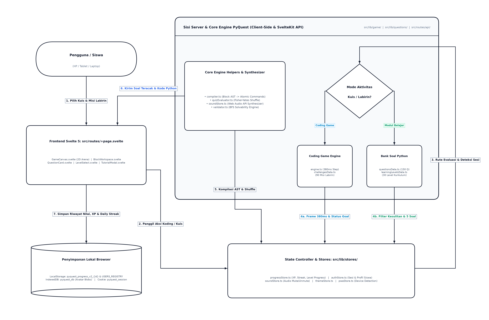
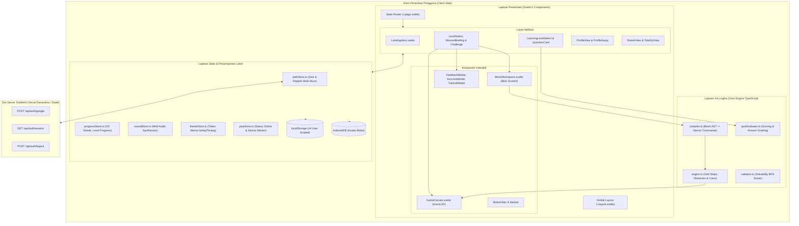
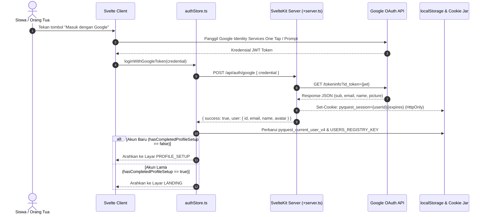
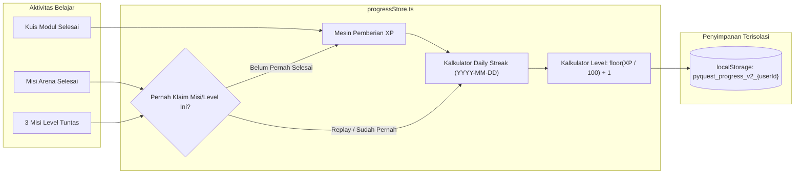
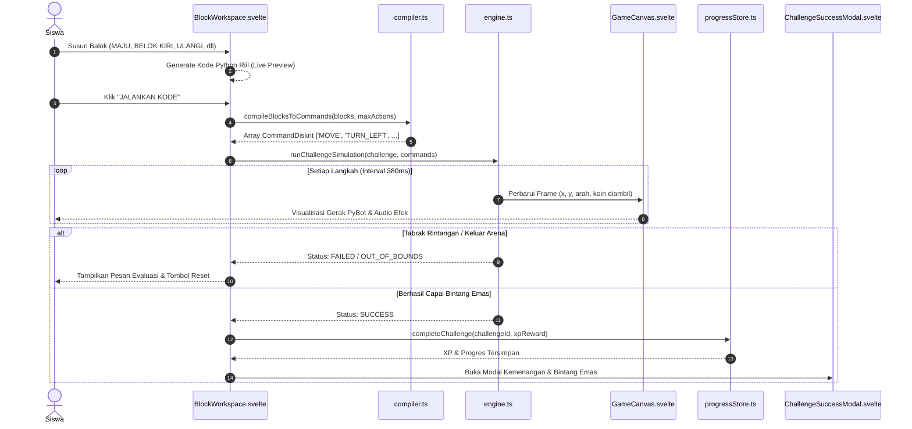
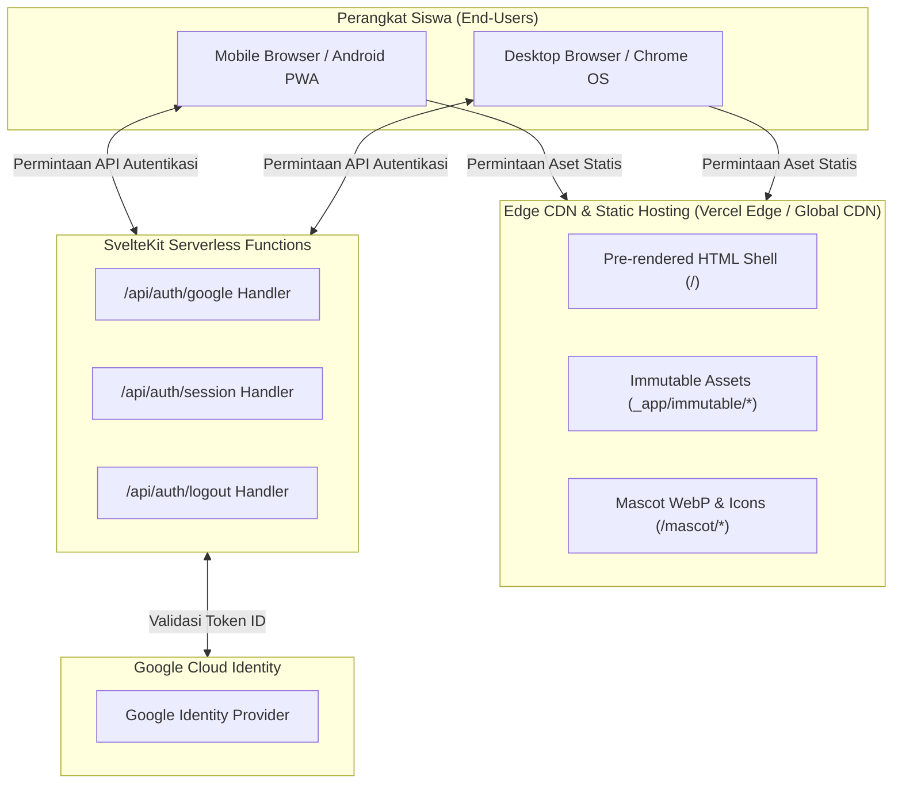

# PyQuest — System Architecture Specification

> **Spesifikasi Arsitektur Sistem, Komponen, dan Aliran Data PyQuest**  
> Repositori: `pyquest` | Target Platform: Web, PWA, Desktop & Mobile  
> Tema Kompetisi: *Innovating Education Through Technology* / *Web Education for Kids*

---

## Daftar Isi
1. [Ikhtisar Proyek & Tujuan Edukasi](#1-ikhtisar-proyek--tujuan-edukasi)
2. [Tumpukan Teknologi Aktual & Versi Runtim](#2-tumpukan-teknologi-aktual--versi-runtime)
3. [Diagram Konteks Sistem (System Context)](#3-diagram-konteks-sistem-system-context)
4. [Diagram Arsitektur Tingkat Tinggi (High-Level Architecture)](#4-diagram-arsitektur-tingkat-tinggi-high-level-architecture)
5. [Tanggung Jawab Modul: Frontend, Backend, dan Persistensi](#5-tanggung-jawab-modul-frontend-backend-dan-persistensi)
6. [Arsitektur Autentikasi & Alur Identitas (Google OAuth & Session)](#6-arsitektur-autentikasi--alur-identitas-google-oauth--session)
7. [Manajemen Status Pengguna & Profil (State Management)](#7-manajemen-status-pengguna--profil-state-management)
8. [Arsitektur XP, Pencapaian, Daily Streak & Pelacakan Progres](#8-arsitektur-xp-pencapaian-daily-streak--pelacakan-progres)
9. [Arsitektur Modul Belajar Python & Evaluasi Kuis](#9-arsitektur-modul-belajar-python--evaluasi-kuis)
10. [Arsitektur Coding Game (Compiler, Simulator & Labirin 2D)](#10-arsitektur-coding-game-compiler-simulator--labirin-2d)
11. [Maskot 3D PyBot & Strategi Pemuatan Aset](#11-maskot-3d-pybot--strategi-pemuatan-aset)
12. [Arsitektur Tema Visual & Audio Sintesis](#12-arsitektur-tema-visual--audio-sintesis)
13. [Arsitektur Progressive Web App (PWA) & Batasan Offline](#13-arsitektur-progressive-web-app-pwa--batasan-offline)
14. [Integrasi API & Ketergantungan Eksternal](#14-integrasi-api--ketergantungan-eksternal)
15. [Konfigurasi Lingkungan & Arsitektur Deployment](#15-konfigurasi-lingkungan--arsitektur-deployment)
16. [Penanganan Galat, Keamanan, Aksesibilitas & Performa](#16-penanganan-galat-keamanan-aksesibilitas--performa)
17. [Keterbatasan Sistem & Rencana Pengembangan Masa Depan](#17-keterbatasan-sistem--rencana-pengembangan-masa-depan)

---

## 1. Ikhtisar Proyek & Tujuan Edukasi

PyQuest adalah platform edukasi interaktif berbasis web yang dirancang khusus untuk memperkenalkan dasar-dasar pemrograman Python kepada anak-anak (usia 8–15 tahun). Aplikasi menggabungkan dua metode pedagogis terpadu:
1. **Modul Belajar Teori & Kuis Bertingkat (30 Level, 150 Soal)**: Membimbing siswa memahami konsep sintaksis Python (variabel, tipe data, operator logika, pengkondisian `if/else`, perulangan `for`/`while`, hingga struktur data list).
2. **Coding Game Labirin 2D (30 Level, 90 Misi)**: Lingkungan pemrograman visual terinspirasi Scratch 3 di mana anak menyusun balok logika diskrit (`MAJU`, `BELOK KIRI`, `BELOK KANAN`, `ULANGI N KALI`, `SELAMANYA`) untuk memandu robot PyBot menyelesaikan misi labirin dan mengumpulkan koin.

### Prinsip Utama Sistem:
- **Client-Side Deterministic First**: Seluruh kompilasi balok, simulasi gerakan labirin, dan evaluasi jawaban kuis dieksekusi 100% di browser pengguna tanpa jeda jaringan dan tanpa model AI berbayar yang rentan berhalusinasi.
- **Aman untuk Anak (*Child-Safe by Design*)**: Tidak mengumpulkan data privasi sensitif, tidak menyertakan iklan, dan tidak memerlukan pelacakan pihak ketiga.
- **Tahan Gangguan Jaringan (Offline-Resilient)**: Seluruh modul materi, aset game, dan suara sintesis dapat dimainkan secara penuh tanpa koneksi internet setelah instalasi awal PWA.

---

## 2. Tumpukan Teknologi Aktual & Versi Runtime

Berdasarkan konfigurasi berkas `package.json`, `svelte.config.js`, dan lingkungan sistem riil:

| Komponen / Lapisan | Teknologi | Versi Aktual | Peran Utama |
|---|---|---|---|
| **Frontend Framework** | Svelte / SvelteKit | Svelte `^5.57.1`, SvelteKit `^3.0.0` | Antarmuka reaktif berbasis Svelte 5 Runes (`$state`, `$derived`, `$props`). |
| **CSS & Design System** | Tailwind CSS v4 | `@tailwindcss/vite ^4.3.3` | Styling modern, mode gelap/terang adaptif tanpa build ganda. |
| **Runtime & Test Runner** | Bun & Node.js | Bun `1.4.2` / Node `24.19.0` | Runtime backend SvelteKit server routes & eksekusi cepat 64 unit tests. |
| **Language & Type System** | TypeScript | `typescript ^6.0.3` | Pengetikan statis pada seluruh antarmuka domain, parser, dan simulator. |
| **Build & Bundler** | Vite | `vite ^8.3.0` | HMR super cepat saat dev dan kompilasi build produksi teroptimasi. |
| **Adapter Deployment** | SvelteKit Adapter | `@sveltejs/adapter-auto ^8.0.0` | Kompatibilitas multi-platform (Vercel Serverless, Node.js server, Static). |
| **Audio Synthesis** | Web Audio API | W3C Standard Browser API | Generator efek suara instan tanpa unduhan berkas MP3/WAV. |
| **Offline & PWA** | Service Worker API | Cache API & `manifest.json` | Pre-cache shell aplikasi, aset WebP maskot, dan offline fallback. |

---

## 3. Diagram Konteks Sistem (System Context)

```mermaid
flowchart TD
    ChildUser["Siswa / Pengguna Anak<br/>(Browser Mobile, Tablet, atau Desktop)"]
    ParentUser["Orang Tua / Guru<br/>(Pendamping Belajar)"]

    subgraph PyQuestPlatform ["PyQuest Web Application (PWA / SPA)"]
        UIApp["Antarmuka Interaktif Svelte 5<br/>(Beranda, Kuis, Arena Koding 2D, Profil)"]
        ClientEngine["Core Engine TypeScript<br/>(Block Compiler, Maze Simulator, Quiz Evaluator)"]
        LocalStores["State Layer & Local Storage<br/>(authStore, progressStore, soundStore, themeStore)"]
        IndexedDBStore[("IndexedDB Browser<br/>(Foto Avatar Kustom)")]
    end

    subgraph ServerSide ["SvelteKit Backend Endpoints"]
        AuthAPI["/api/auth/google & /api/auth/session<br/>(JWT Token Verifier & Session Cookie Guard)"]
    end

    subgraph ExternalServices ["Layanan Pihak Ketiga"]
        GoogleGIS["Google Identity Services (GIS)<br/>accounts.google.com/gsi/client"]
        GoogleTokenAPI["Google Token Verification API<br/>oauth2.googleapis.com/tokeninfo"]
        YouTubeEmbed["YouTube Video CDN<br/>youtube.com/embed/rTYO5_IfQDw"]
    end

    ChildUser -->|Interaksi Bermain & Belajar| UIApp
    ParentUser -->|Pengaturan Profil & Audio| UIApp
    
    UIApp <--> ClientEngine
    UIApp <--> LocalStores
    LocalStores <--> IndexedDBStore

    LocalStores <-->|Kredensial Sesi| AuthAPI
    UIApp <-->|Login Dialog| GoogleGIS
    AuthAPI <-->|Verifikasi Keabsahan ID Token| GoogleTokenAPI
    UIApp -.->|Streaming Tutorial Koding (Opsional)| YouTubeEmbed
```

---

## 4. Diagram Arsitektur Tingkat Tinggi (High-Level Architecture)



> **Berkas Visual Beresolusi Tinggi**: [PNG (4510x2970)](./diagrams/pyquest_system_flowchart.png) | [Vektor SVG](./diagrams/pyquest_system_flowchart.svg)



---

## 5. Tanggung Jawab Modul: Frontend, Backend, dan Persistensi

### 5.1 Frontend (Svelte 5 Runes)
- **Kemandirian Logika (*Client-First Execution*)**: Seluruh kalkulasi rendering, logika evaluasi jawaban kuis, dan simulasi grid per 380ms berlangsung sepenuhnya di CPU pengguna.
- **Manajemen Navigasi SPA**: Menggunakan router terpusat di `src/routes/+page.svelte` yang terintegrasi dengan tumpukan riwayat browser (`popstate`) untuk mencegah pengguna keluar aplikasi saat menekan tombol fisik Back pada perangkat Android.

### 5.2 Backend Runtime (SvelteKit Server Routes)
- **Verifikasi Kredensial Kriptografis**: Endpoint `src/routes/api/auth/google/+server.ts` bertindak sebagai *gatekeeper* yang memvalidasi integritas ID Token JWT ke endpoint resmi Google OAuth 2.0.
- **Proteksi Cookie Sesi**: Menerbitkan dan menghapus cookie HTTP-Only `pyquest_session` dengan atribut keamanan modern (`httpOnly: true`, `sameSite: 'lax'`, `secure: true`, max-age: 30 hari).

### 5.3 Persistensi Data
- **`localStorage` (Tingkat Akun)**: Menyimpan preferensi, riwayat penyelesaian 90 misi (`completedChallenges`), penyelesaian 30 level modul (`completedLearningLevels`), akumulasi XP, dan rekor *daily streak*. Seluruh data dipisahkan secara terisolasi per akun (`pyquest_progress_v2_{userId}`).
- **`localStorage` (Tingkat Perangkat)**: Menyimpan penanda PWA lintas akun (`pyquest_device_id_v1` dan `pyquest_device_pwa_installed_v1`) agar pemasangan aplikasi terdeteksi untuk semua profil yang menggunakan tablet/komputer yang sama.
- **`IndexedDB` (`pyquest_db`)**: Menyimpan berkas gambar avatar kustom hasil unggahan anak untuk mencegah kuota 5MB `localStorage` habis.

---

## 6. Arsitektur Autentikasi & Alur Identitas (Google OAuth & Session)



---

## 7. Manajemen Status Pengguna & Profil (State Management)

Model data pengguna didefinisikan secara ketat pada `src/lib/types/index.ts`:

```typescript
export interface UserProfile {
    id: string;                      // Unik dari Google sub ID
    name: string;                    // Nama lengkap akun
    email: string;                   // Alamat email Google
    avatar: string;                  // URL avatar eksternal, preset stiker, atau idb://
    firstName?: string;              // Nama panggilan anak untuk sapaan hangat
    age?: number;                    // Usia anak (opsional)
    hasCompletedProfileSetup: boolean; // Penanda selesainya onboarding profil
    createdAt: string;               // ISO 8601 Timestamp
    updatedAt: string;
}
```

Store reaktif `authStore` menyediakan:
- `$authStore.currentUser`: Status pengguna aktif saat ini.
- `$authStore.isAuthenticated`: Boolean reaktif untuk *route guards*.
- `$authStore.isSetupDone`: Pengecekan penyelesaian penyiapan profil awal.
- `$dashboardUserStore`: *Derived store* yang secara otomatis menggabungkan profil akun dengan level karakter terkini dari `$progressStore`.

---

## 8. Arsitektur XP, Pencapaian, Daily Streak & Pelacakan Progres



### Formula & Aturan Inti:
1. **Formula Level Karakter**:
   $$\text{Level} = \max\left(1, \left\lfloor \frac{\text{XP}}{100} \right\rfloor + 1\right)$$
   Setiap 100 XP yang diperoleh anak menaikkan 1 tingkat level PyBot.
2. **Perlindungan Anti-Duplikasi Hadiah (*Anti-Duplicate XP Guard*)**:
   Setiap misi tantangan (`Challenge`) memiliki identitas unik `challenge.id`. Sistem mencatat ID tersebut ke dalam array `completedChallenges`. Pada saat pengerjaan ulang (*replay*), misi tetap dapat dimainkan untuk melatih pemahaman logika, namun penambahan reward XP diabaikan.
3. **Daily Streak Berbasis Kalender Lokal**:
   Menggunakan format tanggal lokal perangkat `YYYY-MM-DD`. Jika hari aktivitas terakhir bertepatan dengan kemarin, nilai `streak` bertambah 1. Bila berselang lebih dari 1 hari, nilai `streak` direset ke 1 namun rekor terbaik (`longestStreak`) tetap tersimpan permanen.

---

## 9. Arsitektur Modul Belajar Python & Evaluasi Kuis

### Struktur Kurikulum:
- Terdiri dari 30 level kurikulum berurutan pada `learningLevelsData.ts`.
- Bank soal memuat 150 pertanyaan kurasi pada `questionsData.ts` yang mencakup 17 topik inti: *Syntax Dasar, Variabel, Tipe Data Angka & Teks, Operasi Matematika, Boolean, Logika Percabangan `if/elif/else`, Perulangan `for`/`while`, List, Tuple, Dictionary, String Manipulation, Fungsi Sederhana, dan Algoritma Dasar*.

### Evaluasi Jawaban Deterministik (`quizEvaluator.ts`):
1. **Kunci Jawaban Stabil**: Menggunakan indeks atau ID opsi stabil yang dicocokkan terhadap jawaban benar (`correctAnswerId`).
2. **Pengacakan Tampilan Aman**: Opsi pilihan ganda diacak menggunakan algoritma Fisher-Yates murni tanpa mengubah objek referensi asli bank soal.
3. **Pencegahan Klik Ganda**: Flag evaluasi mengunci opsi seketika setelah pilihan pertama terdaftar.
4. **Petunjuk Pedagogis**: Petunjuk tingkat 1 memberikan panduan konsep, sedangkan petunjuk tingkat 2 memberikan petunjuk analitis tanpa mengungkap jawaban langsung.

---

## 10. Arsitektur Coding Game (Compiler, Simulator & Labirin 2D)

### 10.1 Diagram Urutan Eksekusi Arena (Sequence Diagram)


### 10.2 Kompilasi Balok Scratch ke Perintah Atomik (`compiler.ts`)
Setiap balok visual direpresentasikan sebagai objek `CodingBlock`:
- `MOVE`: Menghasilkan perintah atomik `MOVE` dan kode Python `pybot.move()`.
- `TURN_LEFT`: Menghasilkan perintah atomik `TURN_LEFT` dan kode Python `pybot.turn_left()`.
- `TURN_RIGHT`: Menghasilkan perintah atomik `TURN_RIGHT` dan kode Python `pybot.turn_right()`.
- `REPEAT`: Mengekstrak balok bersarang di dalam badan loop dan mengekspansinya secara deterministik dengan batas iterasi maksimum aman untuk mencegah *infinite loop*.
- `FOREVER`: Menghasilkan loop tak hingga terkontrol yang dibatasi oleh ambang batas keamanan sistem (`maxActions = 100`).

### 10.3 Simulator Gerak Diskrit (`engine.ts`)
- Menghitung koordinat Cartesius grid: $(x, y)$ dan rotasi orientasi diskrit (`UP`, `RIGHT`, `DOWN`, `LEFT`).
- Memvalidasi batas arena: $0 \le x < \text{width}$ dan $0 \le y < \text{height}$.
- Mendeteksi tabrakan koordinat rintangan batu (`obstacles`).
- Menghitung perolehan koin (`coins`) dan memvalidasi sentuhan pada titik target bintang emas (`target`).

---

## 11. Maskot 3D PyBot & Strategi Pemuatan Aset

Maskot PyBot adalah kekayaan intelektual dan identitas visual resmi PyQuest.

### Karakteristik Desain Resmi:
- Bodi robot futuristik dengan lengkungan membulat berwarna putih dan perak mengkilap.
- Visor helm gelap dengan pantulan cahaya berkilau.
- Mata digital bercahaya cyan cerah ramah anak.
- Modul menyerupai headphone di kedua sisi kepala dengan aksen ungu dan biru toska.
- Simbol resmi Python terpampang di bagian dada.

### Strategi Pemuatan & Format Aset:
1. **Konversi WebP Efisiensi Tinggi**: Seluruh berkas grafis maskot dioptimasi ke format WebP modern di direktori `static/mascot/`:
   - `pybot-waving.webp` (25 KB vs PNG asli 153 KB — hemat kuota >83%).
   - `pybot-happy-success.webp` (26 KB vs PNG asli 155 KB).
   - `pybot-front-idle.webp` (27 KB vs PNG asli 178 KB).
   - `pybot-looking-left.webp` & `pybot-looking-right.webp`.
2. **Pre-caching via Service Worker**: Seluruh varian WebP didaftarkan pada daftar precache shell di `src/service-worker.js` sehingga maskot langsung muncul instan tanpa jeda saat halaman dibuka.
3. **Pencegahan Distorsi Proporsi**: Menggunakan kelas CSS Tailwind `object-contain`, dimensi eksplisit `width`/`height`, dan atribut `decoding="async"`.

---

## 12. Arsitektur Tema Visual & Audio Sintesis

### 12.1 Arsitektur Tema (Dark / Light Tokens)
- Dikelola oleh `src/lib/stores/themeStore.ts`.
- Mengontrol atribut `<html data-theme="dark">` dan kelas CSS Tailwind `.dark`.
- Tema gelap menggunakan palet warna luar angkasa: Slate 950 (`#020617`), Slate 900 (`#0f172a`), dan aksen Cyan/Emerald/Indigo.
- Sinkronisasi instan terhadap elemen `<meta name="theme-color">` pada bilah status perangkat seluler.

### 12.2 Audio Sintesis Murni (Web Audio API)
- Dikelola oleh `src/lib/stores/soundStore.ts`.
- Tidak bergantung pada berkas suara statis pihak ketiga.
- Frekuensi dan modulasi diprogram langsung menggunakan `OscillatorNode` (tipe `sine` dan `triangle`) yang dihubungkan ke `GainNode` untuk pengaturan amplop suara (*sound envelope* serangan dan peluruhan / attack & decay).
- Mendukung fitur *mute* global yang tersimpan permanen di `localStorage.getItem('pyquest-sound-enabled')`.

---

## 13. Arsitektur Progressive Web App (PWA) & Batasan Offline

### 13.1 Konfigurasi PWA Manifest & Service Worker
- `static/manifest.json`: Mengatur mode tampilan `display: "standalone"`, orientasi fleksibel dengan panduan otomatis, ikon PWA SVG/PNG, dan warna tema konsisten.
- `src/service-worker.js`:
  - **Pre-cache Shell**: Menyimpan halaman dasar `/`, berkas CSS, skrip JS yang di-*hash*, dan grafis maskot WebP.
  - **Network-First dengan Offline Fallback**: Untuk permintaan navigasi HTML.
  - **Cache-First**: Untuk aset statis dengan nama ber-hash.
  - **Pengecualian Khusus**: Menolak caching untuk endpoint otentikasi `/api/auth/*` demi keamanan token.

### 13.2 Deteksi Perangkat PWA Lintas Akun
- Menggunakan penanda tingkat peramban lokal perangkat: `pyquest_device_id_v1` dan `pyquest_device_pwa_installed_v1`.
- Jika salah satu akun pengguna telah memasang PWA pada perangkat tablet atau komputer tertentu, seluruh akun lain yang masuk di perangkat yang sama tidak akan lagi diganggu oleh tombol pemasangan aplikasi.

### 13.3 Batasan Offline
- Fitur Kuis (150 Soal) dan Coding Game (90 Misi Labirin) bekerja 100% offline.
- Fitur yang memerlukan jaringan internet aktif:
  1. Login pertama kali via Google OAuth (verifikasi tanda tangan JWT ke server Google).
  2. Pemutaran video tutorial YouTube Shorts pada modal bantuan (tersedia panduan teks cadangan jika offline).

---

## 14. Integrasi API & Ketergantungan Eksternal

1. **Google Identity Services (GIS)**:
   - Script loader: `https://accounts.google.com/gsi/client`.
   - Menghasilkan token kredensial ID JWT di sisi klien.
2. **Google OAuth Tokeninfo API**:
   - URL: `https://oauth2.googleapis.com/tokeninfo?id_token={jwt}`.
   - Dipanggil oleh endpoint server SvelteKit `src/routes/api/auth/google/+server.ts` untuk memvalidasi audiens dan masa berlaku token tanpa memerlukan pustaka SDK berat.
3. **YouTube Embedded Player**:
   - URL: `https://www.youtube.com/embed/rTYO5_IfQDw` (Lazy-loaded di `TutorialModal.svelte`).

---

## 15. Konfigurasi Lingkungan & Arsitektur Deployment

### 15.1 Diagram Arsitektur Deployment (Vercel / Cloud)


### 15.2 Konfigurasi Environment Variables
Berdasarkan berkas `.env.example`:
```env
# Variabel Publik Frontend (Aman di sisi klien browser)
PUBLIC_GOOGLE_CLIENT_ID=your_google_client_id_here.apps.googleusercontent.com
VITE_GOOGLE_CLIENT_ID=your_google_client_id_here.apps.googleusercontent.com

# Kredensial Rahasia Sisi Server (HANYA terbaca di server / serverless function)
GOOGLE_CLIENT_ID=your_google_client_id_here.apps.googleusercontent.com
GOOGLE_CLIENT_SECRET=your_google_client_secret_here
```

---

## 16. Penanganan Galat, Keamanan, Aksesibilitas & Performa

### 16.1 Keamanan & Privasi Anak (*COPPA / Privacy Friendly*)
- Tidak ada data siswa yang dikirimkan ke model AI eksternal atau penyedia analitik pelacak.
- Sesi dilindungi dengan cookie HTTP-Only yang kebal dari serangan XSS (*Cross-Site Scripting*).
- Token ID Google selalu diverifikasi di sisi server sebelum sesi baru diterbitkan.

### 16.2 Penanganan Galat (*Error Boundaries & Graceful Degradation*)
- `compiler.ts` menolak eksekusi balok yang berpotensi menghasilkan loop tak terbatas dengan membatasi eksekusi maksimal pada angka `maxActions = 100`.
- Jika video YouTube gagal dimuat akibat proteksi peramban atau mode offline, sistem secara otomatis menampilkan tombol cadangan menuju YouTube resmi dan menampilkan panduan 4 tips koding cepat secara statis.

### 16.3 Aksesibilitas (a11y)
- Tombol dan kontrol navigasi dilengkapi atribut `aria-label` deskriptif.
- Dukungan navigasi papan ketik penuh (tombol `Escape` untuk menutup dialog modal dan tutorial).
- Kontras warna teks memenuhi standar WCAG AA baik pada tema gelap maupun terang.

### 16.4 Optimasi Performa
- Ukuran bundel produksi Svelte 5 sangat ramping (total JS terkompresi gzip < 150 KB).
- Tidak menggunakan pustaka grafis 3D WebGL berat yang menguras baterai gawai anak; efek 3D disajikan melalui aset WebP pre-rendered berkualitas tinggi.
- Tag iframe YouTube di-load secara malas (*lazy-loaded*) hanya saat siswa mengklik tombol tutorial.

---

## 17. Keterbatasan Sistem & Rencana Pengembangan Masa Depan

### 17.1 Keterbatasan Saat Ini
1. **Sinkronisasi Antar-Perangkat Real-time**: Karena menggunakan arsitektur *Local-First Persistence*, kemajuan belajar tersimpan di penyimpanan lokal peramban perangkat. Jika siswa berganti gawai dari tablet sekolah ke laptop rumah, progres tidak otomatis tersinkronisasi tanpa ekspor/impor data.
2. **Ketergantungan Internet pada Login Awal**: Autentikasi Google memerlukan akses jaringan pada saat pendaftaran atau login pertama kali.

### 17.2 Peluang Peningkatan Mendatang
1. **Sinkronisasi Cloud Opsional**: Menambahkan sinkronisasi cloud terenkripsi (misalnya PostgreSQL / Supabase) bagi sekolah yang menginginkan pemantauan progres siswa oleh guru.
2. **Editor Level Kustom (*Custom Level Maker*)**: Fitur bagi siswa untuk merancang labirin tantangan sendiri dan membagikannya ke teman sekelas.
3. **Penyelaras Berkas Offline Audio**: Mode unduh cache video tutorial bagi siswa di daerah dengan akses internet terbatas.
