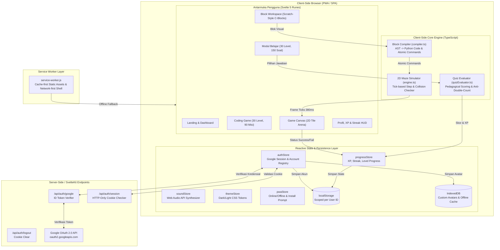
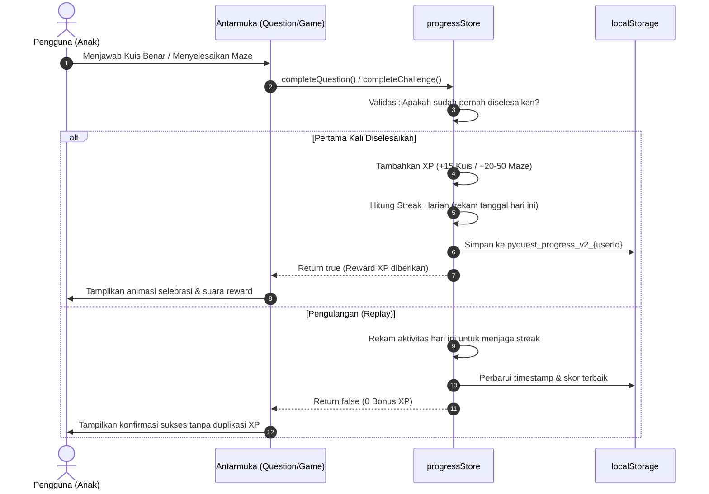
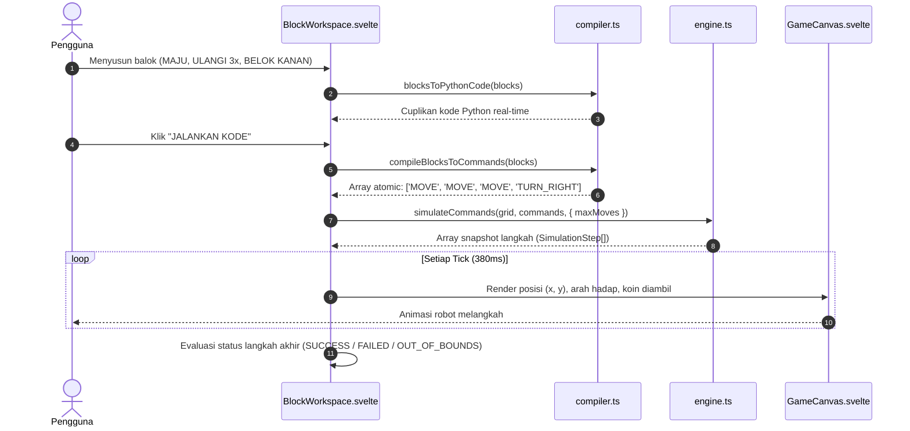

# PyQuest — System Architecture Specification

> **Dokumen Arsitektur Sistem & Aliran Data PyQuest**  
> Web Aplikasi Edukasi Pemrograman Python untuk Anak-anak  
> Tema Kompetisi: *Innovating Education Through Technology* / *Web Education for Kids*

---

## 1. Ringkasan Eksekutif & Prinsip Arsitektur

PyQuest dirancang dengan arsitektur **Deterministic Client-Side First**, di mana 100% kompilasi balok visual, simulasi lintasan robot 2D, dan evaluasi kuis berjalan di sisi klien (in-browser) tanpa ketergantungan API LLM berbayar. Keputusan ini menjamin:
- **Respon Instan (<10ms)** untuk interaksi drag-and-drop dan feedback visual.
- **Bebas Halusinasi (*Zero Hallucination*)**: Seluruh validasi sintaks Python dan logika maze bersifat deterministik.
- **Akses Offline (PWA-Ready)**: Aplikasi dapat dimainkan sepenuhnya saat jaringan internet padam atau tidak stabil.
- **Keamanan & Privasi Anak**: Tidak ada data sensitif anak yang dikirimkan ke model AI pihak ketiga.

---

## 2. Diagram Arsitektur Tingkat Tinggi (Mermaid)

---

## 3. Komponen Utama dan Tanggung Jawab

| Modul / Komponen | Berkas Terkait | Tanggung Jawab Utama |
|---|---|---|
| **State Machine Router** | `src/routes/+page.svelte` | Mengatur navigasi antar-layar SPA (`LOGIN`, `LANDING`, `LEARN_SELECT`, `QUESTION`, `FEEDBACK`, `LEARN_SUCCESS`, `LEVEL_SELECT`, `MISSION_BRIEFING`, `CHALLENGE`, `REWARD`, `SUMMARY`, `PROFILE_SETUP`, `PROFILE`, `MISSIONS`, `XP_PROGRESS`, `STREAK_VIEW`). Mengelola riwayat browser via `popstate` dan tombol Back perangkat mobile. |
| **Block Compiler** | `src/lib/game/compiler.ts` | Mengompilasi susunan balok visual (`MOVE`, `TURN_LEFT`, `TURN_RIGHT`, `REPEAT`, `FOREVER`) menjadi array instruksi atomic diskrit dan string kode Python murni (`pybot.move()`, `while True:`, `for _ in range(n):`). |
| **Game Maze Engine** | `src/lib/game/engine.ts` | Menjalankan simulasi gerak PyBot langkah-demi-langkah, kalkulasi rotasi arah (`UP`, `RIGHT`, `DOWN`, `LEFT`), deteksi tabrakan rintangan, batas grid (*out-of-bounds*), pengumpulan koin, dan kondisi kemenangan bintang emas. |
| **Level & Challenge Validator** | `src/lib/game/validator.ts` | Algoritma Breadth-First Search (BFS) otomatis untuk memverifikasi bahwa seluruh 90 tantangan dapat diselesaikan (*solvable*), batas gerakan (`maxMoves`) realistis, dan tidak ada rintangan yang menghalangi posisi awal maupun target. |
| **Quiz Scoring & Evaluator** | `src/lib/questions/quizEvaluator.ts` | Mengevaluasi jawaban kuis secara deterministik, menghitung persentase skor, mendeteksi kelulusan sempurna (*perfect score*), mencegah manipulasi klik ganda, dan menghitung perolehan XP. |
| **Authentication Store** | `src/lib/stores/authStore.ts` | Mengelola status login Google OAuth, registrasi pengguna multi-profil di localStorage, sinkronisasi cookie sesi HTTP-only, dan guard setup profil. |
| **Progress & Streak Store** | `src/lib/stores/progressStore.ts` | Menyimpan XP, level karakter, lencana pencapaian, rekor streak harian (berbasis tanggal lokal `YYYY-MM-DD`), dan memastikan isolasi data per akun pengguna (`pyquest_progress_v2_{userId}`). |
| **Synthesized Audio Store** | `src/lib/stores/soundStore.ts` | Menghasilkan efek suara interaktif (klik tombol, jawaban benar/salah, pergerakan robot, perolehan koin, kemenangan misi) menggunakan Web Audio API murni tanpa mengunduh berkas audio eksternal. |
| **Theme & Style Store** | `src/lib/stores/themeStore.ts` | Mengelola tema terang/gelap (Dark Mode default bernuansa game sci-fi), sinkronisasi atribut DOM `data-theme`, dan penyesuaian warna status bar mobile (`meta[name="theme-color"]`). |
| **PWA & Offline Store** | `src/lib/stores/pwaStore.ts` | Mendeteksi status online/offline, menangkap event `beforeinstallprompt`, serta menyediakan panduan instalasi PWA khusus untuk Android Chrome dan iOS Safari. |

---

## 4. Aliran Data Aplikasi (Data Flow)

### 4.1 Aliran Progres Belajar & Gamifikasi (XP, Streak, Badges)

### 4.2 Aliran Kompilasi & Simulasi Blok Koding

---

## 5. Keputusan Teknis Penting & Justifikasi (ADR)

1. **Svelte 5 Runes daripada React / Vue**:
   - *Justifikasi*: Mengeliminasi overhead virtual DOM. Kompilasi Svelte menghasilkan vanilla JS yang berukuran sangat kecil (~100kB gzipped untuk seluruh bundle aplikasi), memungkinkan pemuatan instan pada gawai berspesifikasi rendah di sekolah dasar.
2. **Web Audio API Sintesis Alih-alih Berkas Audio MP3/WAV**:
   - *Justifikasi*: Mencegah latensi pemuatan audio, menghemat bandwidth jaringan (~0 byte beban aset audio), dan memastikan audio tetap dapat berbunyi seketika saat aplikasi dijalankan dalam kondisi offline penuh.
3. **Penyimpanan Lokal Multi-Akun Tanpa Database Server Kompleks**:
   - *Justifikasi*: Mematuhi prinsip perlindungan privasi anak (COPPA / GDPR-K). Data pembelajaran tersimpan aman di perangkat lokal pengguna, sementara autentikasi Google digunakan secara aman hanya untuk identitas dan avatar.
4. **Validasi Rute BFS Otomatis dalam Unit Test**:
   - *Justifikasi*: Menjamin integritas pedagogis. 100% dari 90 level game dibuktikan secara matematis memiliki jalan keluar yang valid sebelum kode dirilis ke produksi.
