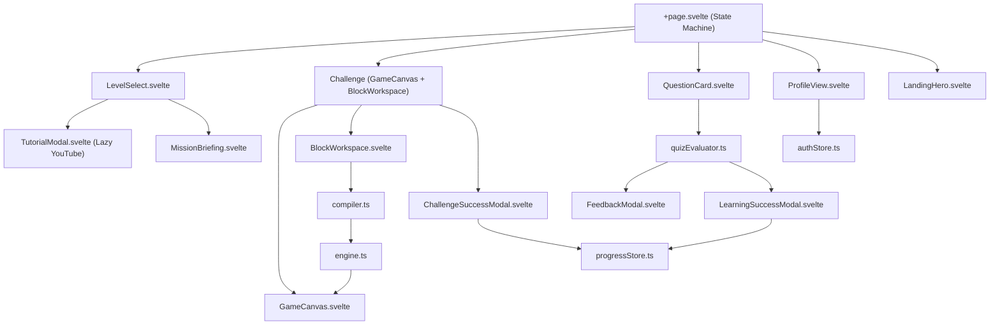

# PyQuest — Project Structure Guide

> **Panduan Struktur Berkas Proyek, Tanggung Jawab Modul, dan Peta Hubungan Kode Sumber**  
> Repositori: `pyquest` | Framework: SvelteKit 3 + Svelte 5 + Tailwind CSS v4 + Bun / Node.js  
> Dokumen Terkait: [Alur Aplikasi (APPLICATION_FLOWS.md)](./APPLICATION_FLOWS.md) | [Spesifikasi Arsitektur (ARCHITECTURE.md)](./ARCHITECTURE.md)

---

## 1. Pohon Direktori Kode Sumber Proyek

Berikut adalah peta struktur berkas utama PyQuest yang relevan bagi pengembangan, pemeliharaan, dan evaluasi teknis aplikasi:

```
pyquest/
├── docs/                               # Dokumentasi Teknis Lengkap
│   ├── diagrams/                       # Gambar Skema Arsitektur Sistem
│   │   ├── pyquest_system_flowchart.png# Gambar alur sistem resolusi tinggi (4510x2970)
│   │   └── pyquest_system_flowchart.svg# Skema vektor alur sistem interaktif
│   ├── APPLICATION_FLOWS.md            # Pemetaan 11 alur pengguna & diagram Mermaid
│   ├── ARCHITECTURE.md                 # Spesifikasi 17 bab arsitektur sistem
│   ├── COMPETITION_READINESS.md        # Kesiapan tema kompetisi & pedagogi
│   ├── FEATURE_INVENTORY.md            # Inventaris lengkap fitur & pengujian
│   ├── PROJECT_STRUCTURE.md            # Peta struktur berkas & tanggung jawab modul
│   └── TEST_REPORT.md                  # Laporan pengujian otomatis & unit test
│
├── static/                             # Aset Statis yang Disajikan Langsung
│   ├── favicon.png & favicon.svg       # Favicon resmi PyQuest
│   ├── manifest.json                   # Web App Manifest untuk dukungan PWA
│   └── mascot/                         # Aset Maskot Resmi 3D PyBot (WebP & PNG)
│       ├── pybot-front-idle.webp       # Pose santai netral (27 KB)
│       ├── pybot-happy-success.webp    # Pose selebrasi juara (26 KB)
│       ├── pybot-looking-left.webp     # Pose orientasi kiri (27 KB)
│       ├── pybot-looking-right.webp    # Pose orientasi kanan (27 KB)
│       └── pybot-waving.webp           # Pose menyapa resmi Beranda (25 KB)
│
├── src/                                # Kode Sumber Inti Aplikasi
│   ├── app.css                         # Direktif Tailwind CSS v4, font, dan token tema
│   ├── app.d.ts                        # Deklarasi tipe global SvelteKit
│   ├── app.html                        # HTML Shell: viewport stabil, theme bootstrap, GSI
│   ├── engine.test.ts                  # 64 unit tests deterministik (Bun Test)
│   ├── service-worker.js               # Service Worker: pre-caching & offline shell
│   │
│   ├── lib/                            # Modul Pustaka Bersama ($lib)
│   │   ├── index.ts                    # Titik ekspor modul pustaka
│   │   ├── assets/                     # Aset vektor internal (favicon.svg)
│   │   │
│   │   ├── challenges/                 # Bank Data Arena Labirin 2D
│   │   │   ├── challengesData.ts       # 90 tantangan misi labirin, rintangan & koin
│   │   │   └── levelsData.ts           # 30 level permainan dalam 8 unit tematik
│   │   │
│   │   ├── questions/                  # Bank Data Modul Teori & Kuis
│   │   │   ├── learningLevelsData.ts   # 30 katalog level materi konsep Python
│   │   │   ├── questionsData.ts        # 150 bank soal kurasi 17 topik Python
│   │   │   └── quizEvaluator.ts        # Logika evaluasi kuis deterministik & scoring
│   │   │
│   │   ├── game/                       # Mesin Penggerak Coding Game
│   │   │   ├── compiler.ts             # Parser balok visual ke Python & perintah atomik
│   │   │   ├── engine.ts               # Simulator diskrit langkah, tabrakan & target
│   │   │   └── validator.ts            # Solver BFS untuk validasi solvabilitas 90 misi
│   │   │
│   │   ├── stores/                     # Manajemen State Reaktif Svelte
│   │   │   ├── authStore.ts            # Autentikasi Google, profil, registri akun
│   │   │   ├── progressStore.ts        # Akumulasi XP, daily streak, rekor level
│   │   │   ├── pwaStore.ts             # Status online/offline & deteksi perangkat PWA
│   │   │   ├── soundStore.ts           # Generator audio Web Audio API synthesizer
│   │   │   └── themeStore.ts           # Penyetel tema Gelap/Terang & meta theme-color
│   │   │
│   │   ├── types/                      # Definisi Kontrak Tipe TypeScript
│   │   │   └── index.ts                # Tipe UserProfile, CodingBlock, Challenge, Level
│   │   │
│   │   ├── utils/                      # Utilitas Pembantu
│   │   │   ├── avatarStorage.ts        # Adapter penyimpanan avatar ke IndexedDB
│   │   │   ├── fullscreen.ts           # Utilitas Fullscreen API untuk mode landscape
│   │   │   └── googleAuth.ts           # Helper pemuatan Google Identity Services SDK
│   │   │
│   │   └── components/                 # Komponen Antarmuka Svelte 5
│   │       ├── BlockWorkspace.svelte   # Workspace balok koding Scratch berujung halus
│   │       ├── BottomNav.svelte        # Navigasi bawah mobile pintar (auto-hide)
│   │       ├── ChallengeHeader.svelte  # Header status misi, target, dan koin
│   │       ├── ChallengeSuccessModal.svelte # Modal selebrasi kemenangan misi game
│   │       ├── CompletedMissionsView.svelte # Galeri riwayat misi yang telah diselesaikan
│   │       ├── FeedbackModal.svelte    # Modal pembahasan jawaban kuis benar/salah
│   │       ├── GameCanvas.svelte       # Kanvas 2D arena labirin & pergerakan PyBot
│   │       ├── GoogleAuthModal.svelte  # Dialog pop-up masuk dengan akun Google
│   │       ├── Icon.svelte             # Komponen pembungkus ikon ramah anak
│   │       ├── InstallGuideModal.svelte# Panduan instalasi PWA (iOS & Android)
│   │       ├── LandingHero.svelte      # Beranda utama, sapaan siswa, kartu ringkasan
│   │       ├── LearningLevelSelect.svelte # Pemilihan 30 level modul materi Python
│   │       ├── LearningSuccessModal.svelte # Modal kelulusan level kuis & akurasi
│   │       ├── LevelSelect.svelte      # Pemilihan 30 level arena Coding Game
│   │       ├── LoginView.svelte        # Halaman gerbang login Google
│   │       ├── MissionBriefing.svelte  # Kartu taklimat misi sebelum masuk arena
│   │       ├── Navbar.svelte           # Navigasi atas untuk desktop/laptop
│   │       ├── OrientationGuard.svelte # Peringatan orientasi mendatar (Landscape)
│   │       ├── ProfileSetup.svelte     # Pengaturan nama & avatar untuk siswa baru
│   │       ├── ProfileView.svelte      # Halaman profil lengkap, statistik, & tema
│   │       ├── PwaInstallButton.svelte # Tombol pasang aplikasi PWA
│   │       ├── PyQuestLogo.svelte      # Logo vektor resmi PyQuest
│   │       ├── QuestionCard.svelte     # Kartu pertanyaan kuis, kode Python, & opsi
│   │       ├── Sidebar.svelte          # Menu navigasi samping untuk desktop/tablet
│   │       ├── SplashScreen.svelte     # Layar pembuka animasi PyBot
│   │       ├── StreakView.svelte       # Detail rekor daily streak & kalender belajar
│   │       ├── SummaryModal.svelte     # Layar rekapitulasi tamat seluruh permainan
│   │       ├── TotalXpView.svelte      # Rincian total XP & level karakter PyBot
│   │       └── TutorialModal.svelte    # Modal pemutar video tutorial YouTube & tips
│   │
│   └── routes/                         # Rute SvelteKit
│       ├── +layout.svelte              # Shell tata letak global (Theme, PWA, Splash)
│       ├── +page.svelte                # State Machine Router & Penangan Tombol Back
│       ├── api/                        # Rute API Sisi Server SvelteKit
│       │   └── auth/
│       │       ├── google/+server.ts   # Verifikasi kredensial Google via tokeninfo
│       │       ├── session/+server.ts  # Validasi cookie sesi pyquest_session
│       │       └── logout/+server.ts   # Penghapusan cookie sesi
│       └── [redirect_routes]/          # Rute kompatibilitas URL (dashboard, profile, dll)
│
├── .env.example                        # Template konfigurasi environment variables
├── package.json                        # Definisi dependensi & skrip npm/bun
├── svelte.config.js                    # Konfigurasi adapter & alias SvelteKit
├── tsconfig.json                       # Konfigurasi pengetikan statis TypeScript
└── vite.config.ts                      # Konfigurasi bundler Vite & Tailwind plugin
```

---

## 2. Tanggung Jawab Modul-Modul Utama

### 2.1 Router & Navigasi Terpusat (`src/routes/+page.svelte`)
- Berfungsi sebagai **Finite State Machine Router** utama untuk aplikasi berarsitektur Single Page Application (SPA).
- Mengelola state layar aktif: `LOGIN`, `LANDING`, `LEARN_SELECT`, `QUESTION`, `FEEDBACK`, `LEARN_SUCCESS`, `LEVEL_SELECT`, `MISSION_BRIEFING`, `CHALLENGE`, `REWARD`, `SUMMARY`, `PROFILE_SETUP`, `PROFILE`, `MISSIONS`, `XP_PROGRESS`, `STREAK_VIEW`.
- Mengontrol riwayat browser (`popstate`) dan mengelola transisi saat tombol fisik Back pada perangkat Android ditekan. Lihat [APPLICATION_FLOWS.md Bab 9](./APPLICATION_FLOWS.md#9-alur-navigasi-tombol-back-mobile--riwayat-browser).

### 2.2 Mesin Koding Visual & Kompiler (`src/lib/game/`)
- **`compiler.ts`**: Mengompilasi susunan balok visual (`CodingBlock`) menjadi instruksi atomik diskrit dan kode Python murni (`pybot.move()`, `pybot.turn_left()`, `for _ in range(N):`, `while True:`). Dilengkapi perlindungan pembatas iterasi maksimum untuk mencegah eksekusi tak berujung.
- **`engine.ts`**: Simulator langkah gerak PyBot di atas grid 2D dengan waktu langkah 380ms per *tick*. Menghitung rotasi arah, batas grid, koin yang diambil, dan kondisi kemenangan.
- **`validator.ts`**: Modul verifikasi otomatis berbasis Breadth-First Search (BFS) yang memastikan seluruh 90 konfigurasi labirin pada `challengesData.ts` dapat diselesaikan (*solvable*) dan memiliki batas langkah (`maxMoves`) yang adil.

### 2.3 Bank Soal & Evaluator Kuis (`src/lib/questions/`)
- **`learningLevelsData.ts`**: Mendefinisikan 30 level pembelajaran teori Python yang terstruktur.
- **`questionsData.ts`**: 150 soal kurasi dengan tipe soal beragam (prediksi output, melengkapi kode, logika algoritma, dan perbaikan sintaksis) mencakup 17 topik fundamental Python.
- **`quizEvaluator.ts`**: Mengevaluasi kebenaran jawaban secara deterministik, mencegah manipulasi klik ganda, dan menghitung persentase kelulusan sempurna (*perfect score*).

### 2.4 State Management & Persistensi (`src/lib/stores/`)
- **`authStore.ts`**: Menyimpan status pengguna Google OAuth, profil anak, dan registri multi-profil lokal `pyquest_users_registry_v4`.
- **`progressStore.ts`**: Menyimpan XP, level karakter, lencana pencapaian, rekor *daily streak*, dan memisahkan data progres secara terisolasi berdasarkan akun (`pyquest_progress_v2_{userId}`).
- **`soundStore.ts`**: Menghasilkan efek audio sintesis menggunakan Web Audio API tanpa berkas eksternal.
- **`themeStore.ts`**: Mengontrol pergantian mode gelap/terang dan sinkronisasi atribut DOM `data-theme`.
- **`pwaStore.ts`**: Mendeteksi status online/offline dan menyimpan penanda perangkat PWA lintas akun.

### 2.5 Komponen Tutorial Coding Game Baru (`src/lib/components/TutorialModal.svelte`)
- Menampilkan modal pemutar video YouTube Shorts resmi (`https://www.youtube.com/embed/rTYO5_IfQDw`) secara *lazy-loaded* (hanya dimuat saat tombol diklik).
- Menyediakan tautan cadangan langsung ke YouTube dan panduan ringkas 4 langkah koding di dalam modal.
- Terintegrasi dengan kartu tutorial pada `LevelSelect.svelte` yang status lewatinya (*dismissal*) tersimpan rapi di `localStorage.getItem('pyquest_coding_tutorial_dismissed')`.

---

## 3. Peta Relasi Antar-Komponen Utama



---

## 4. Konfigurasi Environment & Template Variabel

Aplikasi menggunakan berkas `.env` untuk konfigurasi runtime. Template resmi disediakan pada `.env.example`:

```env
# ==========================================
# Variabel Publik Sisi Klien (Frontend Safe)
# ==========================================
PUBLIC_GOOGLE_CLIENT_ID=your_google_client_id_here.apps.googleusercontent.com
VITE_GOOGLE_CLIENT_ID=your_google_client_id_here.apps.googleusercontent.com

# ==========================================
# Variabel Rahasia Sisi Server (Backend Only)
# ==========================================
GOOGLE_CLIENT_ID=your_google_client_id_here.apps.googleusercontent.com
GOOGLE_CLIENT_SECRET=your_google_client_secret_here
```

> [!CAUTION]
> Nilai `GOOGLE_CLIENT_SECRET` tidak boleh dipaparkan ke sisi klien atau disertakan ke dalam berkas komit Git. Variabel ini hanya diakses oleh SvelteKit server routes pada saat runtime produksi.

---

## 5. Perintah Pengujian, Build, dan Pengembangan

Seluruh perintah berikut telah diverifikasi dan berjalan normal di repositori:

| Perintah | Alat Eksekusi | Deskripsi & Verifikasi |
|---|---|---|
| `bun dev` / `npm run dev` | Vite | Menjalankan server pengembangan lokal dengan Hot Module Replacement (HMR). |
| `bun test` / `npm run test` | Bun Test | Menjalankan 64 unit tests komprehensif (`engine.test.ts`) mencakup game engine, compiler, kuis, auth, dan deteksi perangkat PWA (~350ms). |
| `npm run check` | svelte-check | Melakukan pemeriksaan pengetikan statis Svelte 5 & TypeScript (0 errors, 0 warnings). |
| `npm run build` | Vite + SvelteKit | Menghasilkan bundel produksi teroptimasi beserta Service Worker (`service-worker.js`). |
| `npm run preview` | Vite | Menguji hasil build produksi secara lokal sebelum proses deployment. |

---

## 6. Persyaratan & Arsitektur Deployment

- **Platform Target Utama**: Vercel Serverless / Cloudflare Pages / Node.js Server.
- **Adapter**: Menggunakan `@sveltejs/adapter-auto` yang secara cerdas mendeteksi lingkungan Vercel dan menghasilkan Serverless Function untuk rute `/api/auth/*`.
- **Aset Statis**: Seluruh berkas di direktori `static/` dan output `_app/immutable/` disajikan melalui Edge CDN dengan header `cache-control: public, max-age=31536000, immutable`.
- **Rute Redirection**: Direktori `src/routes/login/`, `src/routes/levels/`, `src/routes/learning/`, `src/routes/profile/` menyediakan handler `+page.server.ts` yang mengalihkan URL lama (*legacy URL*) secara otomatis via HTTP 302 menuju rute SPA terpadu (`/?screen=...`).
